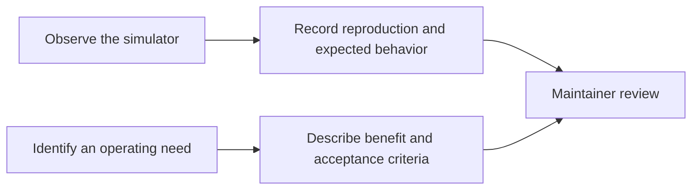

# Issue forms

These GitHub issue forms turn observations and ideas into reproducible engineering work. GitHub discovers the YAML files at this exact conventional location. [Parent guide](../GUIDE.md)



```text
ISSUE_TEMPLATE/
├── README.md            # Form purpose and reporting context
├── bug_report.yml       # Scenario, time, mode, seed, thresholds and browser
└── feature_request.yml  # Problem, proposed benefit and acceptance boundaries
```

The bug form supports the deterministic paths in [engine code](../../src/engine/README.md) and the feature tests described in [test relevance](../../docs/TEST_RELEVANCE.md). Attach evidence containing only simulated data and review screenshots before publishing them. The feature form explicitly asks for production limitations, helping separate current functionality from the [proposed HMI roadmap](../../docs/ROADMAP.md).

No application command runs from these forms. From the project root, use `npm test` for model regressions and `npm run test:e2e` for browser reproductions; see [tests](../../tests/README.md) for setup. `npm run verify:privacy` checks maintained text, but does not establish that every image is free of private information.

Demo talking point: an HMI bug report should explain both the displayed value and its quality/age. In this project those are simulated observations; a report must not imply that a browser reproduction proves a fault on physical equipment.
