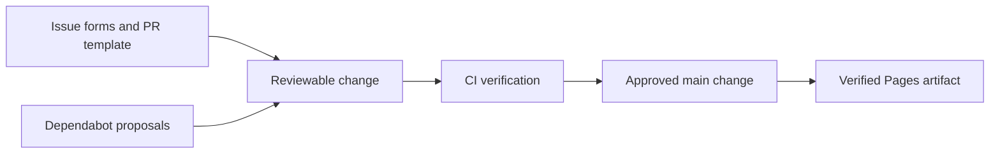

# GitHub collaboration and automation

GitHub reads this directory for issue forms, PR guidance, dependency proposals and Actions workflows. Keep its conventional paths: moving them can silently disable platform behavior. [Repository home](../README.md) · [Current audit](../docs/REPOSITORY_AUDIT.md)



```text
.github/
├── README.md                 # This navigation guide
├── ISSUE_TEMPLATE/           # Reproduction and proposal forms; see its README
├── dependabot.yml            # Weekly npm and GitHub Actions update proposals
├── pull_request_template.md  # Problem, actual validation and publication impact
└── workflows/                # CI, Pages and release automation; see its README
```

The [workflow guide](workflows/README.md) explains how [scripts](../scripts/README.md) and [tests](../tests/README.md) enforce publication boundaries. [Issue forms](ISSUE_TEMPLATE/README.md) ask for reproducible simulation conditions. Dependabot proposals remain separate reviews; an available update is not an instruction to merge it.

From the project root, run `npm run verify:workflows`, `npm test`, and `npm run verify:privacy`. Editing a Markdown guide does not require publishing or running a release helper.

Demo talking point: reproducibility includes scenario, seed, simulation time and browser context. The workflow protects delivery of a tested browser simulator; it does not qualify industrial equipment or provide a safety certification. A main merge also triggers Netlify's independent repository integration, which is configured outside this directory.
