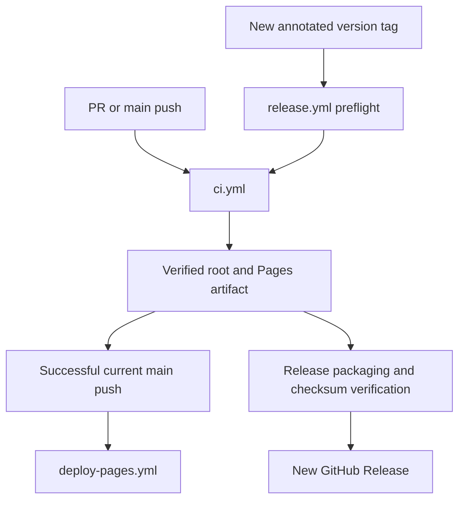

# Verification and publication workflows

These three conventional workflow files validate source, publish the exact tested Pages output and create new versioned releases. Their names and paths are checked by repository tooling. [GitHub guide](../GUIDE.md) · [Deployment details](../../docs/DEPLOYMENT.md)



```text
workflows/
├── README.md         # Trigger, artifact and authority overview
├── ci.yml            # Locked install, checks, two builds, browsers and evidence
├── deploy-pages.yml  # Successful current-main artifact verification and deployment
└── release.yml       # Annotated tag/version agreement, reusable CI and publication
```

`ci.yml` runs on PRs, main pushes and reusable workflow calls using Node 24 and `npm ci`. Type/unit/privacy/workflow/browser/static checks precede production artifact upload. Selected JSON reports pass [report sanitization](../../scripts/README.md) before retention, including on failure paths. Ordinary local runs may regenerate captures; keep deliberate documentation evidence separate from scratch output.

`deploy-pages.yml` accepts only a successful same-repository main **push** producer. It downloads that run's attempt-specific artifact, verifies the expected source SHA and every file hash, checks that source is still main, then deploys `dist-pages` without rebuilding. PR/fork/failed runs cannot authorize this path. Token permissions are scoped per job; checkout credentials are not persisted; action references are full immutable SHAs.

`release.yml` responds to a new `v*` tag, verifies stable version alignment and the annotated tag, reuses CI, packages its exact artifact ID and checks the archive/report bytes. Only the final release job receives `contents: write`; existing published Releases remain unchanged. Running this workflow changes external state, so use the [release handoff](../../docs/DEVOPS_HANDOFF.md) only within an explicitly requested publication task.

Local reproduction from the project root:

```powershell
npm run verify:workflows
npm run typecheck
npm run test:ci
npm run verify:privacy
npm run build
npm run build:pages
npm run test:e2e
npm run verify:static -- --skip-build
```

Local success does not establish a hosted execution. [Current audit](../../docs/REPOSITORY_AUDIT.md) distinguishes fresh baseline GitHub runs, older receipts and this branch's local checks. Netlify independently rebuilds main with `netlify.toml`; it does not consume this CI artifact or inherit the Pages gate.

Demo talking point: this is software delivery evidence for a simulated HMI. Its hash checks protect artifact consistency; they are not hardware qualification, field calibration or proof of equipment safety.
