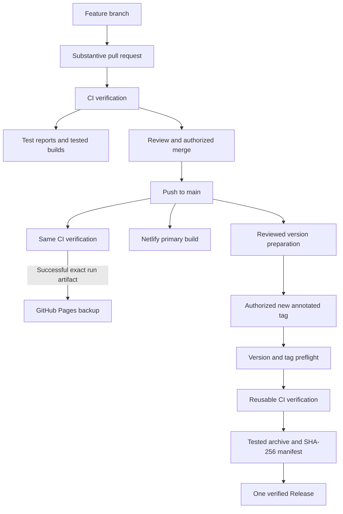
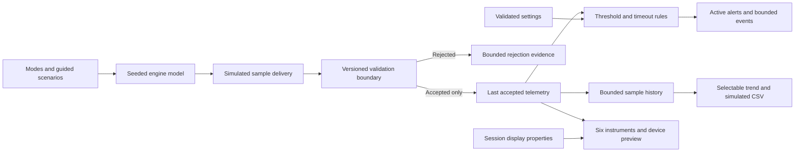

# Cobalt Instrument Studio

_Developed by Daren Diaz_ · [GitHub repository](https://github.com/CloudWizardBoricua/cobalt-instrument-studio)

[](https://github.com/CloudWizardBoricua/cobalt-instrument-studio/actions/workflows/ci.yml)

Fall 2026 · **Version 0.2.0 release preparation**

An original industrial telemetry simulator built to make operating behavior inspectable. One seeded engine model drives six instruments, a live trend, and diagnostic transitions. A versioned sample contract protects accepted readings, while reproducible faults show process failures, rejected deliveries, and recovery. The device workspace lets a reviewer configure a display without changing the model or alert thresholds.

**SIMULATED — NOT LIVE EQUIPMENT.** This static application has no equipment connection, hardware driver, backend, authentication service, safety control, or production certification.


## Published checkpoint and local follow-up

[PR #1](https://github.com/CloudWizardBoricua/cobalt-instrument-studio/pull/1) is merged at main commit `453ea4a126fab0a44f4345871b401a5c11fbce86`. Its [PR CI](https://github.com/CloudWizardBoricua/cobalt-instrument-studio/actions/runs/38341235636), [main CI](https://github.com/CloudWizardBoricua/cobalt-instrument-studio/actions/runs/38341542078), and [Pages deployment](https://github.com/CloudWizardBoricua/cobalt-instrument-studio/actions/runs/38341678181) succeeded; [Netlify's production deployment](https://app.netlify.com/sites/cobalt-instrument-studio/deploys/6acda4604f6f76a89261cafb) is ready at that same commit. Both public sites passed 12 browser tests and matching report-download checks. [Netlify](https://cobalt-instrument-studio.netlify.app/) remains primary and [GitHub Pages](https://cloudwizardboricua.github.io/cobalt-instrument-studio/) the backup. The [v0.1.0 tagged release](https://github.com/CloudWizardBoricua/cobalt-instrument-studio/releases/tag/v0.1.0) remains the unchanged historical snapshot.

Version 0.2.0 on `feat/device-pages-and-evidence` implements five device-preview pages—Gauges, Engine, Trends, Faults, and ACK—and the test-evidence privacy correction. Its graphite/black bezel, metallic rings, cobalt blue/cyan accents, and large white readouts preserve the central simulator and blue visual identity. Local checks passed **100 unit tests and 17 browser tests**; both reports passed full nine-page visual inspection and metadata/link checks. Both production-base builds passed matching report-download checks.

[PR #11](https://github.com/CloudWizardBoricua/cobalt-instrument-studio/pull/11) provides the substantive review. Its [first successful CI run](https://github.com/CloudWizardBoricua/cobalt-instrument-studio/actions/runs/38345451017) passed **100/100 unit and 17/17 Linux Chromium browser tests**, including 30 device layout combinations. Downloaded artifacts passed ZIP digest, exact source/file inventory, report-byte, retention, and privacy inspection; twelve screenshots include the six cockpit captures. [Actual PR artifact evidence](docs/v020-pr-validation.json) identifies the tested revision. Main publication, updated hosting, and the annotated v0.2.0 release still require separate successful execution.

Standby readouts show zero before the first Start or guided Run, including metric display. These are presentation placeholders, not accepted telemetry samples. Start or Run reveals the central accepted values; Pause holds readings/time and Reset restores zero presentation without injecting zeros into the engine, diagnostics, or history. Choose Idle, Normal, High Load, or Fault and adjust speed/load. Selecting a scenario alone does not interrupt the current replay. Seed `27041` makes the five scenarios repeatable:

| Scenario                | Fault type        | Expected behavior                                                                                                                             |
| ----------------------- | ----------------- | --------------------------------------------------------------------------------------------------------------------------------------------- |
| Normal operating ramp   | No injected fault | Speed and load increase; pressure follows and temperature changes gradually.                                                                  |
| Coolant overheat        | Simulated process | Cooling degradation begins at 6 s, crossing warning and critical limits.                                                                      |
| Communication loss      | Sample delivery   | Delivery stops from 5 s through 16.5 s; readings become stale and recover at 17 s.                                                            |
| Oil pressure loss       | Simulated process | Pressure declines from 5 s, progresses through warning and critical, then restores from 24 s and clears after hysteresis/debounce.            |
| Invalid sample delivery | Sample delivery   | Invalid attempts from 5 s through 16.5 s are rejected; the last accepted readings remain, age increases, and valid delivery recovers at 17 s. |

Diagnostics explains threshold triggers, sample rejection reasons, acknowledgment, and recovery. Acknowledgment records review and leaves a continuing condition active. Escalation requires a new acknowledgment. Invalid deliveries cannot update instruments, history, accepted time, or threshold debounce.

## Implemented capabilities

- Six synchronized SVG instruments, four modes, a fixed 0.5 s step, and seeded disturbances.
- A version 1 telemetry boundary: required own numeric fields, finite values, documented plausibility bounds, compatible version, and strictly increasing nonfuture timestamps.
- Accepted data is copied field by field. Rejections preserve the last valid sample; repeated reasons are counted and logged once per rejection episode. A valid delivery records recovery.
- Five guided replays separating simulated process faults from sample delivery faults.
- Configurable thresholds, hysteresis, debounce, acknowledgment, timeout, and transition events; bounded 240-sample history and 100-event retention.
- A collapsible device workspace across Dashboard, Diagnostics, and Settings: six display slots, live accepted-data preview, a six-signal browser, and a selected-slot property editor.
- Five local device pages with shared softkeys: Gauges, Engine, Trends from accepted history, Faults, and ACK wired to central acknowledgment. The physical panel appearance is a simulated browser preview.
- Atomic display edits for binding, label, and finite ordered range within each signal's display domain. Out-of-scale numeric readings remain visible while the needle clamps. Changes do not affect engine commands or diagnostic rules.
- Responsive three-view layout, visible keyboard focus, meaningful control/gauge descriptions, day/night appearance, reduced motion, and textual condition states.
- Validated local preferences, metric/imperial display, gauge visibility, and simulated CSV exports. Telemetry/events and device layout remain session memory only.
- Shared-source engineering PDF/DOCX and authentic browser captures, synchronized into both hosting builds.

Read [the telemetry contract](docs/TELEMETRY_CONTRACT.md) for fields, units, rejection categories, ordering, and recovery semantics. Read [the handoff](docs/HANDOFF.md) for observed outcomes and current validation.

## Run and validate

Requires Node.js 24 and npm. Dependencies are project-local.

```sh
npm ci
npm run verify:workflows
npm run typecheck
npm run test:ci
npm run verify:privacy
npm run build
npm run build:pages
npm run test:e2e
npm run verify:static -- --skip-build
npm run verify:privacy
node scripts/prepare-test-reports.mjs
```

Start the local preview separately with `npm run dev`. On Windows PowerShell, use `npm.cmd` if execution policy blocks `npm.ps1`. Local browser tests use installed Microsoft Edge by default; `PW_BROWSER_CHANNEL=chrome` selects installed Chrome. CI installs Linux Chromium with `npx playwright install --with-deps chromium` before browser checks. The [first PR CI run](https://github.com/CloudWizardBoricua/cobalt-instrument-studio/actions/runs/38341235636) has successfully executed these checks on GitHub.

`npm run build` creates root assets in `dist`. `npm run build:pages` creates `/cobalt-instrument-studio/` assets in `dist-pages`. Both include PDF/DOCX downloads. View changes use local state and require one static HTML entry point. The published application needs only static assets and visitor-side JavaScript.

## Development and release workflow

The existing [CI](.github/workflows/ci.yml), [Pages](.github/workflows/deploy-pages.yml), and [release](.github/workflows/release.yml) workflows are improved through [PR #1](https://github.com/CloudWizardBoricua/cobalt-instrument-studio/pull/1). PR/main CI and the CI-gated Pages path have successfully executed for that earlier checkpoint. Version 0.2.0 is approved for the same reviewed publication process and new tag-release verification after final checks. The badge above points to the real CI workflow on `main`.

| Trigger | Configured behavior in this local revision |
| --- | --- |
| Pull request, including Dependabot updates | `CI verification` installs the committed lockfile with `npm ci`, checks TypeScript, runs unit and privacy/content checks, builds both hosting bases, and runs Playwright. Production files are retained as `cobalt-production-builds-<attempt>` for 14 days after success. Test reports, screenshots, and available failure traces are retained as `cobalt-test-results-<attempt>` for 7 days, including failed runs. |
| Push to `main` after a reviewed merge | The same CI runs. Pages accepts only a successful main push from this repository, downloads that exact run's tested artifact, and deploys `dist-pages`. Netlify's existing repository integration builds `main` and publishes `dist` as the primary site. |
| New annotated semantic version tag | Release preflight requires tag, package, changelog, notes, and report versions to agree. The reusable CI must pass before packaging and publication. A tested archive, engineering PDF/DOCX, manifest, and SHA-256 checksums accompany one Release. Existing tags and Releases are preserved. |



Run the commands in **Run and validate** to reproduce the checks locally. `test:ci` writes a unit JSON report; `verify:static -- --skip-build` checks already-built root/project assets and exact report downloads in a browser. On Linux, install Chromium before browser tests and set `CI=true` when running them. Artifacts contain selected build/test outputs rather than the whole checkout and have temporary retention. GitHub artifact downloads require sign-in and repository read access. [GitHub artifact documentation](https://docs.github.com/en/actions/how-tos/manage-workflow-runs/download-workflow-artifacts)

Protection for `main` is [enabled and verified](docs/workflow-governance-validation.json): PRs and **`CI verification`** from GitHub Actions are required, strict checks and administrator enforcement are on, force pushes/deletions are blocked, and conversations must be resolved. No additional reviewer approval is required by the rule. The [older unprotected baseline](docs/workflow-remote-baseline.json) remains historical. [Dependabot configuration](.github/dependabot.yml) covers npm and GitHub Actions; those PRs use the same CI trigger.

The [earlier PR execution record](docs/workflow-pr-validation.json) confirms **92/92 unit tests, 12/12 Linux Chromium browser tests**, and source-bound production artifacts. [Download that inspected production build](https://github.com/CloudWizardBoricua/cobalt-instrument-studio/actions/runs/38341235636/artifacts/11786956557) with GitHub sign-in; its observed retention is 14 days. Inspection found unnecessary Git contact metadata in temporary Playwright test artifacts. Both affected test artifacts were [deleted after approval](docs/workflow-governance-validation.json); production artifacts remain. Version 0.2.0 disables the capture, sanitizes reports, and gates their upload on preparation success, including failing test runs. Fresh CI artifact inspection is still required for this correction.

Current [production HTTP/deployment evidence](docs/workflow-production-validation.json) verifies main commit, providers, assets, and exact report hashes. Separate [production browser evidence](docs/workflow-production-browser.json) records **12/12 checks on each site**, including the five scenarios, workspace, controls, and 18 view/theme/width combinations per origin. The enhanced Pages workflow has executed successfully; the initial Release still has its two historical reports, and the enhanced release path has not run for a new version.

**Historical published baseline:** [successful main CI](https://github.com/CloudWizardBoricua/cobalt-instrument-studio/actions/runs/38333357919), [successful Pages deployment](https://github.com/CloudWizardBoricua/cobalt-instrument-studio/actions/runs/38333358441), and [ready Netlify deployment](https://app.netlify.com/sites/cobalt-instrument-studio/deploys/6acd8c5cd6fa3bd467203c8f) identify the previously verified production snapshot. The Netlify dashboard may require account access. The [initial release run](https://github.com/CloudWizardBoricua/cobalt-instrument-studio/actions/runs/38331500958) produced [v0.1.0](https://github.com/CloudWizardBoricua/cobalt-instrument-studio/releases/tag/v0.1.0) from the [annotated tag](https://github.com/CloudWizardBoricua/cobalt-instrument-studio/tree/v0.1.0), with [PDF](https://github.com/CloudWizardBoricua/cobalt-instrument-studio/releases/download/v0.1.0/Cobalt_Engineering_Report.pdf) and [DOCX](https://github.com/CloudWizardBoricua/cobalt-instrument-studio/releases/download/v0.1.0/Cobalt_Engineering_Report.docx) assets. That unchanged initial release has no static-build archive or checksum manifest. [PR #1](https://github.com/CloudWizardBoricua/cobalt-instrument-studio/pull/1) is merged and its [PR CI run succeeded](https://github.com/CloudWizardBoricua/cobalt-instrument-studio/actions/runs/38341235636). Main CI and deployment verification are tracked separately above. [DevOps handoff](docs/DEVOPS_HANDOFF.md)

## Architecture



Pure engine and diagnostic modules live under `src/engine`. One reducer owns the simulator session. A display-only layout maps accepted signals into fixed device slots. Fixed simulation time preserves seeded replay when browser scheduling varies; the 500 ms interval is a scheduling target, not a real-time guarantee. Timeout age uses simulation time and stops while paused.

Canonical units are rpm, psi, degrees F, volts, and percent. Metric display converts pressure/temperature without changing stored samples, display editor units, or alert thresholds. Temperature has first-order inertia, pressure follows speed/load/thermal state, voltage follows speed/fault state, and fuel decreases with load. These are accelerated demonstration assumptions, not calibrated equipment equations.

## Validation evidence

The initial local baseline passed **32 unit tests and 7 browser tests**. The earlier hardening checkpoint passed **58/58 unit tests and 12/12 browser tests**. Version 0.2.0 passed **100/100 unit tests across eight files** and **17/17 browser tests** locally. Browser checks covered 30 device-page/theme/width combinations and the existing 18 application accessibility combinations, with no JavaScript errors. Browser wall time was 37.817 s; the unit runner took 2.56 s. Six authentic cockpit captures were retained. All nine pages of each report passed visual QA; metadata dates/authors and repository links passed checks. Both hosting builds passed 12 check groups each with matching 459,765-byte PDF and 554,147-byte DOCX downloads. New remote execution remains pending. [Current local evidence](docs/validation-evidence.json) and [engineering handoff](docs/HANDOFF.md)

The subsequent local DevOps validation passed **92/92 unit/release/workflow tests** across six files and **12/12 browser tests** using installed Edge against the production preview. A clean isolated `npm ci` using the unchanged lockfile, typecheck, privacy/content checks of 87 text files, both build commands, and 12 static-browser check groups per hosting base passed with exact report hashes. The three workflows passed their contract checks and Actionlint 1.7.12 reported no core diagnostics; optional ShellCheck/Pyflakes checks were unavailable. Browser failure screenshots and retained failure traces are configured. The local release dry run verified five attachments and preserved all 14 static-file hashes through archive extraction. [DevOps local evidence](docs/devops-local-validation.json) records this measured local checkpoint; the [first successful PR CI run](https://github.com/CloudWizardBoricua/cobalt-instrument-studio/actions/runs/38341235636) separately establishes GitHub execution. [DevOps handoff](docs/DEVOPS_HANDOFF.md)

Meaningful checks cover invalid-data isolation, timestamp ordering, timeout/recovery, deterministic new scenarios, acknowledgment/escalation/hysteresis, buffer caps, device properties, existing controls, keyboard focus, reduced motion, and desktop/mobile layouts. Controlled clocks make guided paths repeatable; a separate real-time browser smoke check observes updates and pause behavior. Actual screenshots capture implemented states.

The previously recorded [public browser](docs/public-browser-validation.json), [public HTTP](docs/public-http-validation.json), and [release](docs/release-validation.json) checks are historical publication evidence. They do not describe the new local revision. No hardware measurement, certification, Safari/Firefox result, physical iPhone/cellular check, assistive-technology audit, frame-rate benchmark, heap benchmark, long-duration soak, or uptime guarantee is claimed.

## Demonstration and future production requirements

| Area                | Implemented locally                                                    | Separate future requirement                                                                                 |
| ------------------- | ---------------------------------------------------------------------- | ----------------------------------------------------------------------------------------------------------- |
| Input contract      | Browser-generated, versioned samples with plausibility/ordering checks | Calibrated device schema, identity, sequence numbers, clocks, unit negotiation, and gateway framing         |
| Fault handling      | Deterministic process and sample delivery replays                      | Field fault characterization, multi-fault policy, hardware testing, and safe operational response           |
| Device workspace    | Session-only signal bindings, labels, and display ranges               | Target display export/runtime, arbitrary widgets, validated import, and layout persistence                  |
| Safety/security     | Display and simulator only; no credentials or equipment control        | Hazard analysis, separated safety controls, authenticated devices, permissions, and integrity checks        |
| Records/reliability | Bounded memory, local CSV, and repeatable checks                       | Durable audited records, cross-browser/device coverage, performance/soak evidence, monitoring, and rollback |

CAN/J1939 remains a hypothetical future interface. No protocol adapter or physical display runtime is implemented.

## Reports and next publication review

- [Local engineering report PDF](docs/Cobalt_Engineering_Report.pdf)
- [Local editable engineering report DOCX](docs/Cobalt_Engineering_Report.docx)
- [Completed work and prioritized future improvements](docs/ROADMAP.md)
- [Historical hosting and future publication process](docs/DEPLOYMENT.md)
- [Changelog](CHANGELOG.md)

Both reports are generated from `docs/report-source.json` using `scripts/build-report.py`, independently of site operation. The version 0.2.0 reports include device pages, current local counts, and separate historical GitHub checkpoints. PDF and DOCX each passed visual inspection of all nine pages, metadata checks, and adjacent repository-link verification. Updated main hosting and the new annotated tag/Release are approved; actual new run/download links will be recorded after execution.

React, TypeScript, Vite, Recharts, Lucide, and Vitest provide the implementation stack. No project license has been selected; dependency licenses remain applicable.
