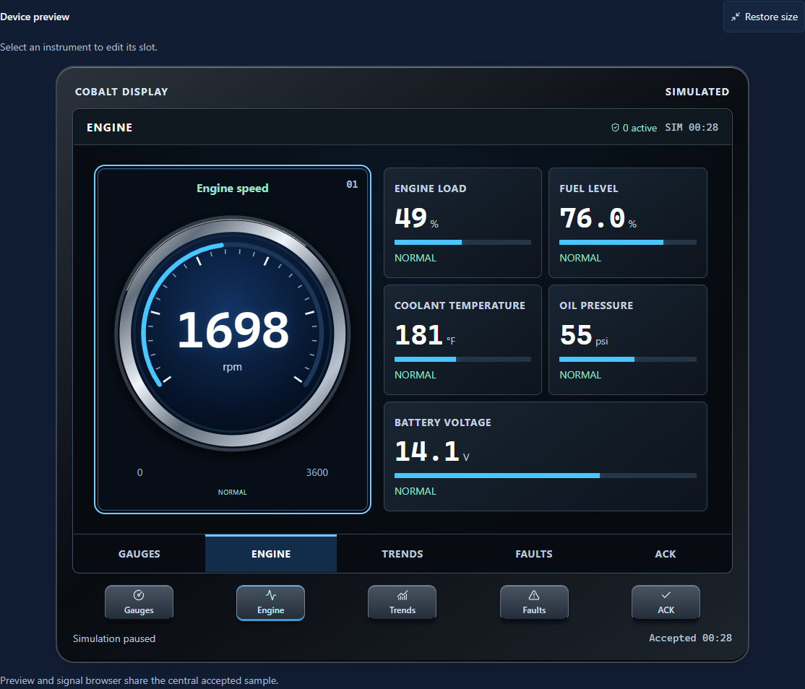
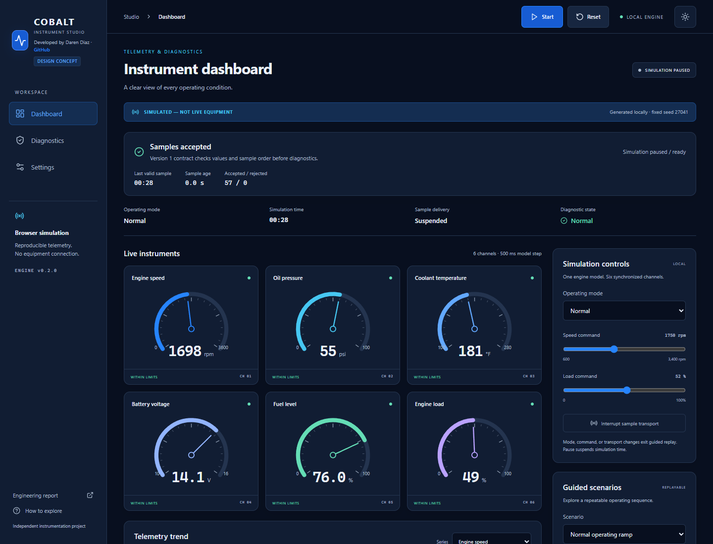
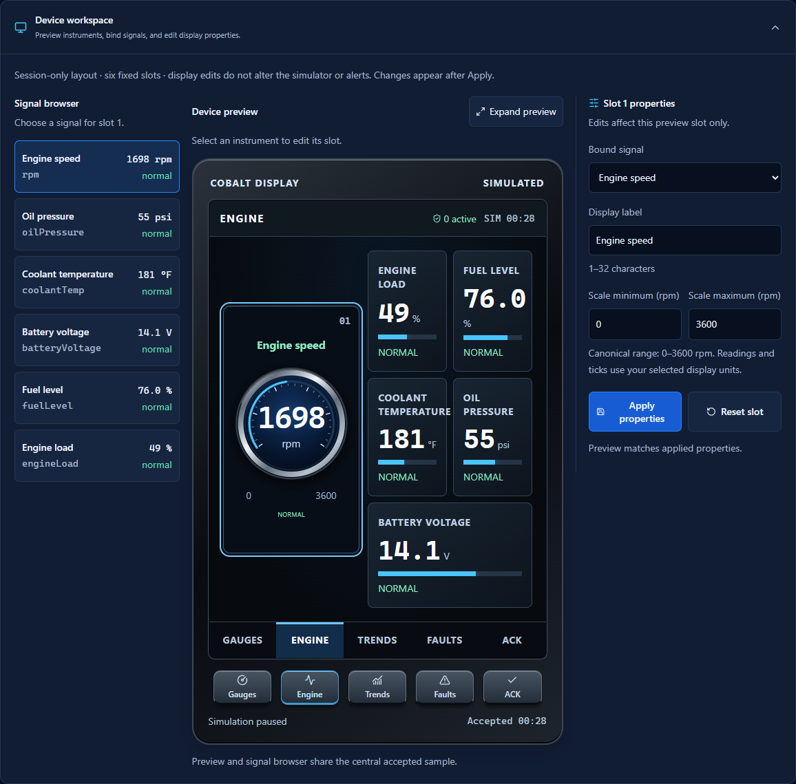
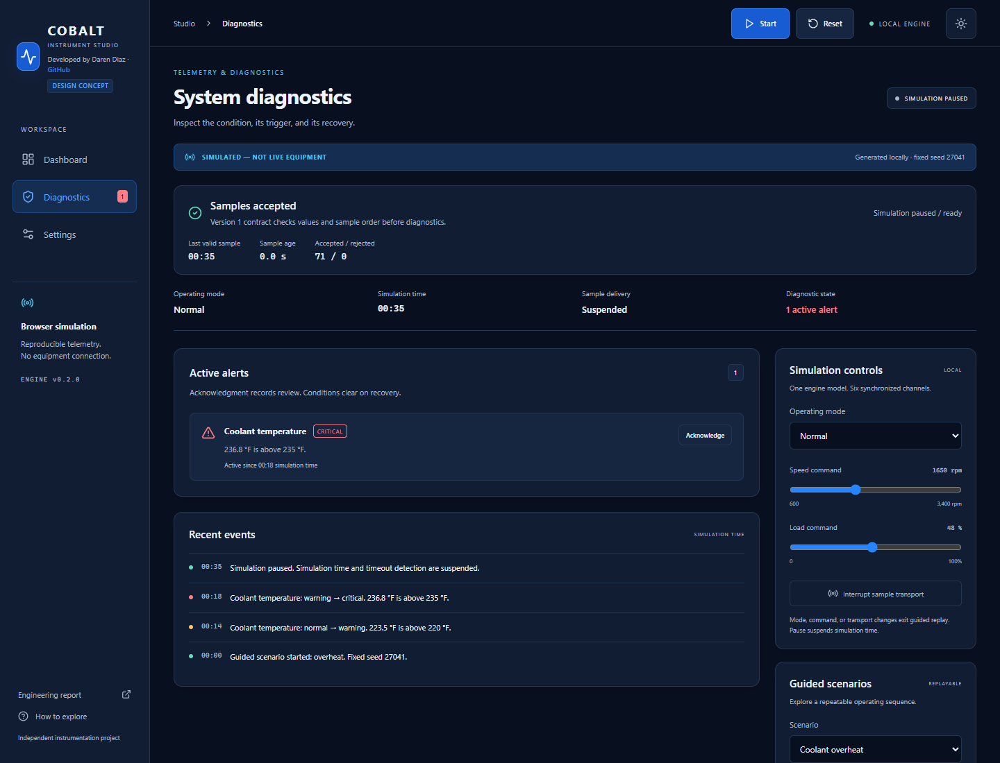
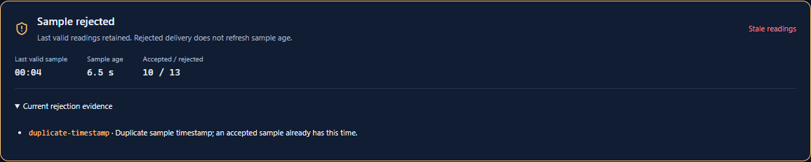
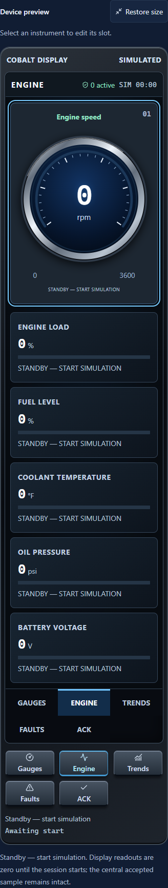
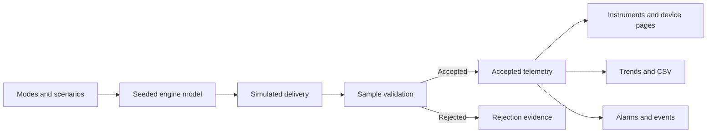

# Cobalt Instrument Studio

**An interactive industrial instrument dashboard, built to make telemetry and faults easy to explore.**

Watch six instruments respond to a shared engine simulation, replay a fault, inspect rejected samples, and configure a five-page device display—all in your browser.

[**Launch the demo →**](https://cobalt-instrument-studio.netlify.app/) · [GitHub Pages mirror](https://cloudwizardboricua.github.io/cobalt-instrument-studio/) · [Six-minute walkthrough](docs/DEMO_WALKTHROUGH.md) · [Engineering report](docs/Cobalt_Engineering_Report.pdf)

[](https://github.com/CloudWizardBoricua/cobalt-instrument-studio/actions/workflows/ci.yml)

Developed by Daren Diaz · [Independent design concept](https://github.com/CloudWizardBoricua/cobalt-instrument-studio) · v0.2.0 · Fall 2026



*The Engine page brings six simulated signals into one device-style display. Gauges, Engine, Trends, Faults and ACK share the same session.*

> **SIMULATED — NOT LIVE EQUIPMENT.** Cobalt generates its data locally. This is a browser-based HMI (human-machine interface) concept, with no equipment connection or safety-control function.

[Screenshots](#screenshots) · [Features](#implemented-capabilities) · [Try it](#start-here-for-the-demo) · [Quick start](#run-and-validate) · [Architecture](#architecture) · [Documentation](#repository-navigation)

## Screenshots

### A dashboard for the whole operating picture

Six synchronized instruments show engine speed, oil pressure, coolant temperature, battery voltage, fuel level and engine load. Sample acceptance, age and diagnostic state remain visible alongside the readings.



*Pause the simulation to inspect a moment in time. Reset returns the instruments to standby.*

### Configure the display beside its preview

Choose a signal, edit its label and scale, then apply the change to a display slot. The signal browser, device preview and property editor sit together so each edit has a visible result.



*Display edits affect presentation; simulation values and alarm thresholds stay independent.*

### Follow a fault through diagnostics

Inspect the active condition alongside its transition history. Acknowledgment records that a condition was reviewed; the fault stays active until the simulated process recovers.



### See why a sample was rejected

Invalid samples cannot replace the last accepted readings. The interface exposes the rejection reason, accepted/rejected counts and sample age, so held values can be distinguished from fresh data.



<details>
<summary><strong>View the narrow-screen device layout</strong></summary>

<p align="center">
  
</p>

*The device view stacks its signals on narrow screens. This capture shows standby before the simulation starts.*

</details>

Screenshots show simulated data. Capture context is documented in the [asset guide](docs/assets/README.md).

## Implemented capabilities

| Capability | What you can explore |
| --- | --- |
| **One model, six signals** | Seeded disturbances and a fixed 0.5-second simulation step keep the instruments, trends and diagnostics consistent. |
| **Repeatable fault scenarios** | Normal operation, coolant overheat, communication loss, oil pressure loss and invalid sample delivery. |
| **Validated telemetry** | Versioned samples, finite values, plausibility bounds and increasing timestamps protect accepted readings. |
| **Alarm lifecycle** | Warning/critical transitions, debounce, hysteresis, timeout, acknowledgment and recovery. |
| **Configurable device preview** | Six display slots and five pages: Gauges, Engine, Trends, Faults and ACK. Edit bindings, labels and display ranges. |
| **Presentation controls** | Day/night appearance, metric/imperial units, keyboard focus, textual condition cues and reduced-motion behavior. |
| **Export and inspect** | Simulated CSV export, bounded trend/event history and downloadable engineering reports. |

Preferences persist locally when browser storage permits. Device layouts, telemetry and events are session-only. See the [telemetry contract](docs/TELEMETRY_CONTRACT.md) for validation and recovery rules.

## Start here for the demo

1. **Start the engine.** Open the [demo](https://cobalt-instrument-studio.netlify.app/) and select **Start** in the toolbar. Pause to inspect the readings; Reset returns to standby.
2. **Replay a fault.** Under Guided scenarios, select **Coolant overheat**, then **Run scenario**. Open Diagnostics to watch the condition move through warning and critical states.
3. **Inspect bad data.** Run **Invalid sample delivery**. Rejected samples hold the accepted readings; delivery recovers at 17 simulation seconds.
4. **Build a display.** Scroll to Device workspace, select a slot, change its label or range and apply it. Visit Engine, Trends, Faults and ACK.

Guided runs use seed `27041` for repeatable demonstrations. Selecting a scenario prepares a draft; **Run scenario** starts it. The [presenter walkthrough](docs/DEMO_WALKTHROUGH.md) includes timing, talking points and recovery steps.

## Run and validate

Requires **Node.js 24 and npm**. From the repository root:

```sh
npm ci
npm run dev
```

Open the local address Vite prints in the terminal. The simulator needs no database, gateway or .NET runtime.

| Command | Purpose |
| --- | --- |
| `npm run typecheck` | Check TypeScript types. |
| `npm run verify:paths` | Check exact-case source imports and filename collisions. |
| `npm run test:ci` | Run the unit suite and write a local JSON result. |
| `npm run verify:workflows` | Validate workflow contracts and action references. |
| `npm run verify:privacy` | Check maintained text and required simulation disclosures. |
| `npm run build` | Build the root-hosted site into `dist`. |
| `npm run build:pages` | Build the project-relative site into `dist-pages`. |
| `npm run test:e2e` | Run browser checks. |
| `npm run verify:static -- --skip-build` | Verify both existing production builds. |

<details>
<summary><strong>Platform notes and generated evidence</strong></summary>

On Windows PowerShell, use `npm.cmd` if execution policy blocks `npm.ps1`. Browser tests use installed Microsoft Edge by default; `PW_BROWSER_CHANNEL=chrome` selects installed Chrome. On Linux, install Chromium with `npx playwright install --with-deps chromium` and set `CI=true` for browser checks.

Run both build commands before static verification. Browser/static verification can overwrite tracked screenshots and evidence files; review those diffs before committing. `node scripts/prepare-test-reports.mjs` sanitizes generated reports for publication. Full sequences and limitations are in the [validation guide](docs/DEMO_VALIDATION.md).

</details>

## Architecture

**React 19 · TypeScript · Vite · Recharts · Lucide · Vitest · Playwright**

The browser owns a single simulation session. Pure engine modules generate samples, validate delivery and evaluate diagnostics. Components render the accepted state.



Canonical units are rpm, psi, degrees Fahrenheit, volts and percent. Metric conversion happens during rendering. History is capped at 240 samples and events at 100. Read the [engine guide](src/engine/README.md) for module responsibilities.

## Repository navigation

```text
cobalt-instrument-studio/
├── src/
│   ├── App.tsx          # Session state and application layout
│   ├── components/      # Dashboard, diagnostics and device workspace
│   ├── engine/          # Simulation, telemetry, alarms and display layouts
│   └── styles/          # Theme, responsive layouts and device styling
├── tests/               # Unit suites and browser flows
├── scripts/             # Build, verification, report and release helpers
├── public/              # Static favicon and report downloads
├── docs/                # Walkthrough, architecture, screenshots and evidence
└── .github/             # CI, Pages, releases and contribution templates
```

| Explore | Start here |
| --- | --- |
| Present the project | [Six-minute walkthrough](docs/DEMO_WALKTHROUGH.md) |
| Understand the implementation | [Source](src/README.md) · [Engine](src/engine/README.md) · [Components](src/components/README.md) · [Styles](src/styles/README.md) |
| Understand the tests | [Test guide](tests/README.md) · [Browser checks](tests/e2e/README.md) · [Test relevance](docs/TEST_RELEVANCE.md) |
| Build and publish | [Scripts](scripts/README.md) · [Automation guide](.github/GUIDE.md) · [Deployment](docs/DEPLOYMENT.md) |
| Find reports and captures | [Documentation index](docs/README.md) · [Assets](docs/assets/README.md) · [Public files](public/README.md) |
| Review the polish checkpoint | [Repository audit](docs/REPOSITORY_AUDIT.md) · [Rename map](docs/DEMO_POLISH_PLAN.md) · [Validation](docs/DEMO_VALIDATION.md) |

Directory guides provide diagrams, annotated trees and local context. The `.github` directory uses `GUIDE.md` so GitHub displays this project README on the repository homepage.

## Validation evidence

The recorded repository-polish checkpoint passed **100 unit tests**, **17 browser tests**, both hosting builds and **12 static verification groups per hosting base**. These are recorded results; the CI badge above links to main's workflow status.

[Full validation and limitations](docs/DEMO_VALIDATION.md) · [Test assessment](docs/TEST_RELEVANCE.md) · [Usability review](docs/DEMO_USABILITY.md) · [Security review](docs/SECURITY_REVIEW.md)

## Development and release workflow

Pull requests and main pushes run CI verification. GitHub Pages deploys the validated artifact from a successful main CI run; Netlify independently rebuilds the repository. Both serve the static simulator at their configured hosting bases.

The [deployment guide](docs/DEPLOYMENT.md) covers publication. The [workflow guide](.github/workflows/README.md) explains CI, artifact retention and tagged releases. Build commands and public report paths are shared with the existing release process.

## Production roadmap

The next proposed direction is an offline-capable industrial-PC HMI with a local C#/.NET gateway, equipment adapters, durable history and alarm acknowledgment, operator roles and supervised deployment. **These capabilities are future work.**

The current simulator has no hardware driver, backend, authentication service or production certification. Hardware qualification and safety functions remain separate engineering responsibilities.

[Proposed HMI architecture](docs/HMI_ARCHITECTURE.md) · [Phased engineering roadmap](docs/ROADMAP.md)

## Reports and publication evidence

| Resource | Download or read |
| --- | --- |
| Engineering report | [PDF](docs/Cobalt_Engineering_Report.pdf) · [Editable DOCX](docs/Cobalt_Engineering_Report.docx) |
| Published v0.2.0 release | [Release notes and assets](https://github.com/CloudWizardBoricua/cobalt-instrument-studio/releases/tag/v0.2.0) |
| Released reports | [PDF](https://github.com/CloudWizardBoricua/cobalt-instrument-studio/releases/download/v0.2.0/Cobalt_Engineering_Report.pdf) · [DOCX](https://github.com/CloudWizardBoricua/cobalt-instrument-studio/releases/download/v0.2.0/Cobalt_Engineering_Report.docx) |
| Release verification | [Static archive](https://github.com/CloudWizardBoricua/cobalt-instrument-studio/releases/download/v0.2.0/Cobalt_Static_Build_v0.2.0.tar.gz) · [Manifest](https://github.com/CloudWizardBoricua/cobalt-instrument-studio/releases/download/v0.2.0/release-manifest.json) · [SHA-256 checksums](https://github.com/CloudWizardBoricua/cobalt-instrument-studio/releases/download/v0.2.0/SHA256SUMS.txt) |
| Project history | [Changelog](CHANGELOG.md) · [DevOps handoff and historical receipts](docs/DEVOPS_HANDOFF.md) |

Reports preserve the reviewed v0.2.0 engineering checkpoint; they do not reflect the current simulation session. The [report source](docs/report-source.json) and [report builder](scripts/build-report.py) are included in the repository.

No project license has been selected. Dependency licenses remain applicable.
