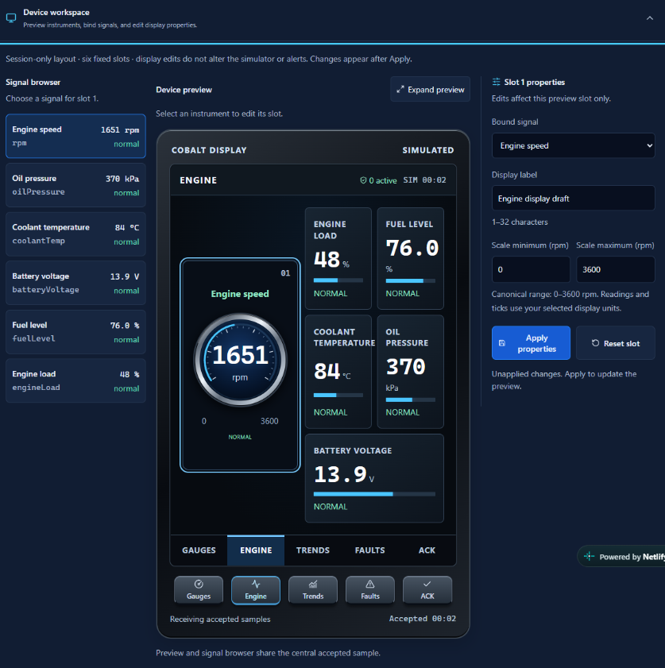
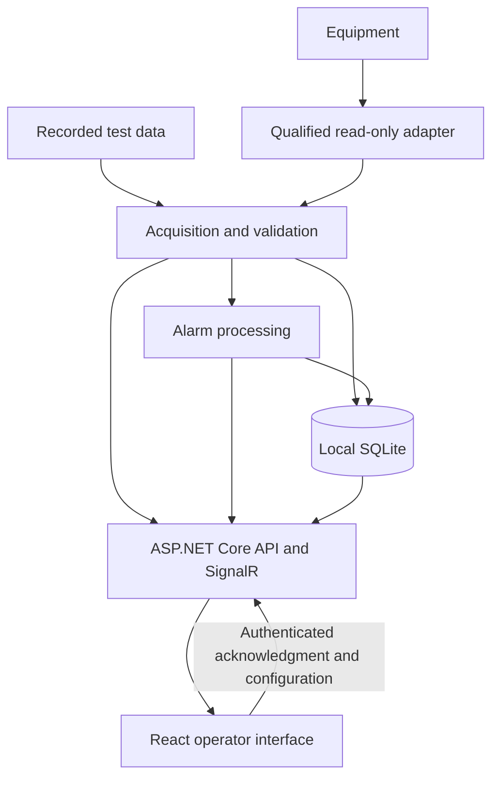

# Cobalt Instrument Studio

## Start here for the demo

Use the [presenter walkthrough](docs/DEMO_WALKTHROUGH.md) for a six-minute application and source tour. An **HMI (human-machine interface)** helps an operator understand equipment conditions; this project demonstrates that presentation using generated data. The application behavior and both public hosting URLs are preserved by the repository cleanup.

| Need | Start here |
| --- | --- |
| Present the application and explain the code | [Demo walkthrough](docs/DEMO_WALKTHROUGH.md) |
| Understand the desktop/GitHub state and unmerged work | [Repository audit and PR recommendations](docs/REPOSITORY_AUDIT.md) |
| Review naming, before/after structure and rename map | [Polishing plan](docs/DEMO_POLISH_PLAN.md) |
| See baseline/final results and deployment limits | [Sprint validation](docs/DEMO_VALIDATION.md) |
| Understand why tests remain | [Test relevance](docs/TEST_RELEVANCE.md) |
| Review demo clarity and security evidence | [Usability review](docs/DEMO_USABILITY.md) · [Security review](docs/SECURITY_REVIEW.md) |

_Developed by Daren Diaz_ · [GitHub repository](https://github.com/CloudWizardBoricua/cobalt-instrument-studio)

[](https://github.com/CloudWizardBoricua/cobalt-instrument-studio/actions/workflows/ci.yml)

Fall 2026 · **Version 0.2.0** · Independent design concept

Cobalt is an industrial telemetry simulator and HMI design concept. One seeded engine model drives six instruments, trends, and diagnostic transitions. A versioned telemetry boundary protects accepted readings, and a device workspace lets a reviewer configure displays without changing the model or alarm thresholds.

**SIMULATED — NOT LIVE EQUIPMENT.** The implemented application is a static browser simulator. It has no equipment connection, hardware driver, backend, authentication service, safety control, or production certification.

The proposed product direction is an **offline-capable industrial-PC HMI for monitoring equipment and acknowledging alarms**, retaining React/TypeScript and adding a local C# gateway. The architecture and roadmap below describe future work; they do not add these capabilities to the current application.

Try the [Netlify demo](https://cobalt-instrument-studio.netlify.app/) or [GitHub Pages backup](https://cloudwizardboricua.github.io/cobalt-instrument-studio/). Start with [Run and validate](#run-and-validate), then read the [proposed HMI architecture](docs/HMI_ARCHITECTURE.md) and [engineering roadmap](docs/ROADMAP.md).




The device workspace capture shows an unapplied display-label draft. These retained screenshots show the simulator, not connected equipment.

## Implemented capabilities

- Six synchronized SVG instruments, four operating modes, a fixed 0.5 s simulation step, and seeded disturbances.
- A version 1 sample contract with required own numeric fields, finite values, demonstration plausibility bounds, and strictly increasing nonfuture timestamps. Rejections retain accepted readings and record bounded rejection/recovery evidence.
- Thresholds, hysteresis, debounce, acknowledgment, escalation, timeout and transition events. Acknowledgment leaves an ongoing condition active; escalation requires renewed acknowledgment.
- Five guided replays covering normal operation, coolant overheat, communication loss, oil pressure loss and invalid sample delivery.
- Six display slots with atomic binding/label/range edits and five device pages: Gauges, Engine, Trends, Faults and ACK. Display edits do not change the engine or diagnostic rules. Out-of-scale values remain visible while needles clamp.
- Dashboard, Diagnostics and Settings views; keyboard focus, textual condition cues, day/night appearance and reduced-motion behavior.
- Validated local preferences, metric/imperial display, simulated CSV export, and shared-source engineering PDF/DOCX reports. History is capped at 240 samples and events at 100; telemetry, events and device layout are session-only.

Start/Pause and Reset appear in the top toolbar on every view. Before Start or guided Run, zero readouts are presentation placeholders and never enter telemetry or diagnostics. Pause holds simulation time and readings; Reset restores standby presentation. Selecting a scenario alone does not interrupt the current replay. Seed `27041` makes guided runs repeatable.

| Scenario | Delivery/process behavior |
| --- | --- |
| Normal operating ramp | Speed/load rise; pressure follows and temperature changes gradually. |
| Coolant overheat | Cooling degradation starts at 6 s and crosses warning/critical limits. |
| Communication loss | Delivery stops from 5 s through 16.5 s; readings become stale and recover at 17 s. |
| Oil pressure loss | Valid low-pressure readings progress through warning/critical; pressure restores from 24 s and clears after hysteresis/debounce. |
| Invalid sample delivery | Invalid attempts from 5 s through 16.5 s cannot update readings, history or threshold debounce; delivery recovers at 17 s. |

See the [implemented telemetry contract](docs/TELEMETRY_CONTRACT.md) for units, rejection categories and recovery semantics.

## Run and validate

The current simulator requires **Node.js 24 and npm**. Dependencies are project-local; no .NET runtime, database or gateway is required.

```sh
npm ci
npm run dev
```

Run checks from a separate terminal:

```sh
npm run verify:workflows
npm run typecheck
npm run verify:paths
npm run test:ci
npm run verify:privacy
```

The existing build/browser verification sequence is:

```sh
npm run build
npm run build:pages
npm run test:e2e
npm run verify:static -- --skip-build
npm run verify:privacy
node scripts/prepare-test-reports.mjs
```

On Windows PowerShell, use `npm.cmd` if execution policy blocks `npm.ps1`. Local browser tests use installed Microsoft Edge by default; `PW_BROWSER_CHANNEL=chrome` selects installed Chrome. On Linux, install Chromium with `npx playwright install --with-deps chromium` and set `CI=true` for browser checks.

**Generated evidence:** E2E writes screenshots into tracked `docs/assets`, and static verification writes tracked evidence. Review those diffs and preserve approved historical captures unless intentionally replacing them. This sprint fixes the Windows newline-sensitive test fixture; separating generated output paths remains future work. See [current results](docs/DEMO_VALIDATION.md) and the [roadmap](docs/ROADMAP.md#phase-0--establish-a-dependable-baseline).

`npm run build` creates root assets in `dist`; `npm run build:pages` creates project-relative assets in `dist-pages` for `/cobalt-instrument-studio/`. Both include report downloads. Navigation uses local state and one HTML entry point. These commands build the static demo; the proposed installed HMI does not yet have build or installation commands.

## Repository navigation

Every maintained directory has its own README with a diagram, annotated tree and demo context. Dependencies, generated builds, caches and Git internals are excluded.

```text
cobalt-instrument-studio/
├── README.md                 # Main run instructions and navigation
├── CHANGELOG.md              # Released version history
├── index.html                # Conventional Vite HTML entry
├── package.json              # Dependency ranges and command entry points
├── package-lock.json         # Reproducible resolved dependency versions
├── vite.config.ts            # Hosting base and Vitest configuration
├── playwright.config.ts      # Local/CI browser configuration
├── tsconfig.json             # Strict TypeScript and consistent filename casing
├── netlify.toml              # Existing Netlify build/output/security headers
├── .gitattributes            # Existing text-line-ending policy
├── .gitignore                # Dependencies, generated outputs and local secrets excluded
├── .github/                  # CI, Pages, releases, issue/PR templates and Dependabot
├── src/                      # React application, pure engine and styles
├── tests/                    # Eight unit suites and two browser suites
├── scripts/                  # Build, evidence, privacy, verification and release helpers
├── public/                   # Stable favicon and frozen report download copies
└── docs/                     # Engineering guides, audit, demo tour and historical evidence
```

| Directory | Purpose and next step |
| --- | --- |
| [src](src/README.md) | React mount and application ownership. |
| [src/engine](src/engine/README.md) | Seeded process, accepted telemetry, diagnostics, settings and layouts. |
| [src/components](src/components/README.md) | Views, instruments and display editing; no hardware acquisition. |
| [src/styles](src/styles/README.md) | Existing theme/cascade, responsive and reduced-motion rules. |
| [tests](tests/README.md), [tests/e2e](tests/e2e/README.md) | Feature contracts and assembled browser flows. |
| [scripts](scripts/README.md) | Keep command paths stable; distinguish verification from publication. |
| [.github](.github/README.md), [workflows](.github/workflows/README.md), [issue templates](.github/ISSUE_TEMPLATE/README.md) | Automation and contribution entry points. |
| [public](public/README.md), [reports](public/reports/README.md) | Copied static files and existing public download names. |
| [docs](docs/README.md), [assets](docs/assets/README.md) | Current sprint deliverables and frozen prior evidence. |

Conventions: PascalCase React components; descriptive lowercase hyphenated domain/test/style/script files; conventional tool/config filenames retained. JSON configuration uses its required syntax, so field purposes are documented here and in directory guides instead of adding invalid comments. `src/engine/instruments.ts` holds catalog/display metadata; `studio-state.ts` owns session transitions; `device-layout.ts` is presentation configuration. See the [complete rename mapping](docs/DEMO_POLISH_PLAN.md#naming-convention-and-proposed-moves).

`npm run verify:paths` checks exact spelling of relative source imports and case collisions independently of Windows path resolution. `forceConsistentCasingInFileNames` also remains enabled in TypeScript. The existing CI contract is preserved; a future CI policy change can add the new navigation check explicitly.

## Architecture

### Current implementation

The frontend uses React, TypeScript, Vite, Recharts and Lucide, with Vitest and Playwright for validation. Pure domain modules under `src/engine` handle the model, sample acceptance and diagnostics. One browser reducer owns the simulation session.

```mermaid
flowchart TD
  Commands[Modes and guided scenarios] --> Model[Seeded engine model]
  Model --> Transport[Simulated sample delivery]
  Transport --> Contract[Versioned validation boundary]
  Contract -->|Accepted only| Received[Last accepted telemetry]
  Contract -->|Rejected| Validation[Bounded rejection evidence]
  Received --> Diagnostics[Threshold and timeout rules]
  Received --> History[Bounded sample history]
  Received --> Gauges[Instruments and device preview]
  History --> Trend[Trend and simulated CSV]
  Diagnostics --> Alerts[Active alerts and events]
```



Canonical units are rpm, psi, degrees F, volts and percent. Metric appearance converts pressure/temperature during rendering. The model uses accelerated demonstration assumptions, not calibrated equipment equations. Fixed simulation time preserves replay despite browser scheduling variation; the 500 ms interval is not a real-time guarantee. **Pausing also stops freshness and timeout evaluation.** That simulator behavior must not govern a live HMI.

### Proposed production HMI

**Status: proposed, not implemented.** Start with one local service and a kiosk browser on a Windows industrial PC. The backend owns acquisition, live alarm evaluation, durable records and authorization; the browser owns presentation and engineering drafts. Acquisition must continue with no browser open.



| Layer | Implemented today | Proposed infrastructure and responsibility |
| --- | --- | --- |
| Frontend | React/TypeScript views coupled to the simulator reducer | Source-independent runtime; explicit demo/live modes; operator views and engineering workspace; connection/quality states; persisted versioned layouts. |
| Backend | None | .NET 10 LTS, ASP.NET Core REST APIs, SignalR and acquisition/alarm background services. Serve bundled frontend assets from the same local service. |
| Equipment boundary | Generated samples and simulated delivery | A fixture adapter first, then one qualified read-only equipment adapter. Validate identity, signal metadata, units, sequence and quality before use. |
| Telemetry and alarms | Browser-owned samples, simulation clock, local acknowledgment | Per-signal freshness, independent watchdogs, backend-authoritative alarm instances and actor/revision-specific durable acknowledgments. |
| Storage and identity | Local preferences; session-only history/layout/events; no accounts | Local SQLite for bounded history, configuration and audit records; locally provisioned viewer/operator/engineer roles. |
| Deployment | Static Netlify and GitHub Pages demos | Supervised Windows service plus Edge kiosk, offline startup, local health/logging, backup/restore, signed packages and tested rollback. |

The backend proposal uses [.NET 10 LTS](https://dotnet.microsoft.com/en-us/platform/support/policy), [SignalR](https://learn.microsoft.com/en-us/aspnet/core/signalr/javascript-client?view=aspnetcore-10.0) and [Windows service hosting](https://learn.microsoft.com/en-us/dotnet/core/extensions/windows-service). SQLite storage belongs on local, nonsynchronized disk; [WAL requires same-host storage](https://sqlite.org/wal.html). These are design choices for future implementation, not installed dependencies.

The live contract will be separate from simulator v1. It must distinguish measurement time, receipt time and monotonic watchdog time; support partial signal updates; and reconcile reconnects through snapshots and event cursors. Initial live readings are unavailable until accepted. Rejected or disconnected input retains the last valid value with explicit quality/age. Live mode must never silently substitute simulated values.

Acknowledgment is an authenticated alarm-record operation, not an equipment command. Safety functions remain in the equipment/controller. Hardware model, protocol, calibration and performance budgets require qualification; CAN/J1939 is only a candidate. See [HMI architecture](docs/HMI_ARCHITECTURE.md) for interfaces, storage, security and recovery requirements.

## Production roadmap

All phases below are **future work**. Implementation follows agreed contracts, integration requirements and measurable acceptance criteria.

| Phase | Exit criterion |
| --- | --- |
| 0. Dependable baseline | Portable tests, reviewed development dependency updates and generated evidence separated from approved captures; checks pass on Windows and Linux. |
| 1. Product boundary | Contract/role/target requirements documented; fixture adapter agreed; equipment selection gates hardware work. |
| 2. Connected monitoring | Fixture-fed gateway drives the UI; acquisition survives browser closure; stale/disconnected/reconnected states are correct. |
| 3. Durable operation | History/configuration/ACK persist; permissions, concurrent ACK, escalation conflicts, restart and storage failure are tested. |
| 4. Equipment qualification | One read-only driver passes controlled bench checks for scaling, partial signals, bad/delayed data, reboot and cable recovery. |
| 5. Installed pilot | Offline boot, recovery, restore, rollback, panel usability and sustained resource bounds are demonstrated on the target IPC. |

The [detailed roadmap](docs/ROADMAP.md) defines dependencies, implementation deliverables and acceptance scenarios. Later work includes multiple devices, Linux qualification, richer widgets, layout deployment, remote services and separately designed equipment controls. No project license has been selected; license selection and third-party notices are prerequisites for distribution.

## Development and release workflow

The current pipeline serves the **static simulator**. [CI](.github/workflows/ci.yml) checks locked dependencies, types, unit/privacy tests, both hosting bases and browser behavior. [Dependabot](.github/dependabot.yml) covers npm and GitHub Actions; actions use immutable references and scoped permissions.

| Trigger | Existing workflow behavior |
| --- | --- |
| Pull request or main push | `CI verification` runs checks and retains selected test reports for 7 days and successful production builds for 14 days. Failure reports are sanitized before upload. |
| Successful main CI | [Pages](.github/workflows/deploy-pages.yml) validates and deploys that run's tested artifact, rejecting superseded source revisions. |
| Main push to Netlify integration | Netlify independently rebuilds `dist`; this path is not gated by GitHub CI. |
| New annotated semantic version tag | [Release](.github/workflows/release.yml) checks source/version consistency, reuses CI and publishes a tested archive, reports, manifest and SHA-256 checksums. Existing releases are preserved. |

See [deployment documentation](docs/DEPLOYMENT.md) for the existing process and [DevOps handoff](docs/DEVOPS_HANDOFF.md) for historical execution and repository-protection receipts. Those receipts establish their recorded checkpoints; this documentation review did not reverify provider deployments or branch-protection settings. The installed HMI will need a separate service packaging, update and recovery path.

## Validation evidence

**Latest repository-polishing results:** see [DEMO_VALIDATION.md](docs/DEMO_VALIDATION.md). The checkpoints below are retained historical evidence, with their original source revisions and limitations. They do not describe the final polishing branch.

### Repository review baseline

The planning review inspected `b92b1f736aa2bab91438ba687fa7b31d64748bf1`, matching GitHub `main` at that check. The review covered frontend architecture, backend/device integration and delivery infrastructure. Source review and local checks do not establish hardware behavior or deployed-service readiness.

| Check during planning | Observed result |
| --- | --- |
| TypeScript, workflow validator, privacy/content | Passed; privacy/content inspected 108 text files. |
| Unit suite | 98/100 passed in the Windows sandbox. One junction-creation test failed during setup and passed on an isolated rerun outside the sandbox (3/3 report tests). The other failure is an LF-only test mutation that misses a CRLF checkout; the workflow validator itself correctly rejects the intended invalid fixture. |
| Dependency advisory queries | Full npm audit reported three development package entries: two critical and one moderate in the Vitest chain. Production-only audit reported zero advisories. These are advisory observations, not verified exploitability or a security certification. |
| Browser/build/deployment/hardware checks | Not rerun for the planning review; existing browser/static checks can overwrite tracked captures/evidence. |

The [roadmap findings](docs/ROADMAP.md#repository-review-findings) record source evidence and remediation priorities. This planning snapshot is separate from historical release results and will age as dependencies and source change.

### Local documentation update checks

Local validation of this documentation revision passed TypeScript, workflow and privacy/content checks plus all 10 privacy/content regression tests. All 45 local links/anchors across the three edited documents were checked, including existing inbound README links. All three Mermaid diagrams were rendered and visually inspected at README width. The full unit suite, application builds and application E2E tests were not rerun locally for this documentation-only change; remote deployments were not reverified. GitHub CI results are recorded separately on the pull request. The known baseline findings above remain open.

### Published version and verification

**Verified v0.2.0 release baseline:** commit `5e7615a98478ae14301da4377c9e6a2255cd2139` through [PR #11](https://github.com/CloudWizardBoricua/cobalt-instrument-studio/pull/11). Retained receipts record 100/100 unit and 17/17 browser tests, both hosting deployments, and five inspected release attachments. These counts describe that release checkpoint, not a fresh run of the reviewed main commit.

- [Local release checkpoint](docs/validation-evidence.json) and [engineering handoff](docs/HANDOFF.md).
- [PR CI/artifact inspection](docs/v020-pr-final-validation.json) and [main CI/artifact inspection](docs/v020-main-ci-validation.json).
- [Public HTTP/deployment inspection](docs/v020-production-validation.json) and [public browser checks](docs/v020-production-browser.json).
- [Tagged release/archive inspection](docs/v020-release-validation.json) and [DevOps receipt index](docs/DEVOPS_HANDOFF.md).

No hardware measurements, production certification, formal assistive-technology audit, target-panel performance/soak result or uptime guarantee is established by these simulator checks.

## Reports and publication evidence

- [Engineering report PDF](docs/Cobalt_Engineering_Report.pdf) and [editable DOCX](docs/Cobalt_Engineering_Report.docx).
- [Proposed HMI architecture](docs/HMI_ARCHITECTURE.md), [engineering roadmap](docs/ROADMAP.md), [implemented telemetry contract](docs/TELEMETRY_CONTRACT.md) and [changelog](CHANGELOG.md).
- [Verified v0.2.0 Release](https://github.com/CloudWizardBoricua/cobalt-instrument-studio/releases/tag/v0.2.0): [PDF](https://github.com/CloudWizardBoricua/cobalt-instrument-studio/releases/download/v0.2.0/Cobalt_Engineering_Report.pdf), [DOCX](https://github.com/CloudWizardBoricua/cobalt-instrument-studio/releases/download/v0.2.0/Cobalt_Engineering_Report.docx), [tested static archive](https://github.com/CloudWizardBoricua/cobalt-instrument-studio/releases/download/v0.2.0/Cobalt_Static_Build_v0.2.0.tar.gz), [manifest](https://github.com/CloudWizardBoricua/cobalt-instrument-studio/releases/download/v0.2.0/release-manifest.json) and [SHA-256 checksums](https://github.com/CloudWizardBoricua/cobalt-instrument-studio/releases/download/v0.2.0/SHA256SUMS.txt).
- [Historical v0.1.0 Release](https://github.com/CloudWizardBoricua/cobalt-instrument-studio/releases/tag/v0.1.0): [PDF](https://github.com/CloudWizardBoricua/cobalt-instrument-studio/releases/download/v0.1.0/Cobalt_Engineering_Report.pdf) and [DOCX](https://github.com/CloudWizardBoricua/cobalt-instrument-studio/releases/download/v0.1.0/Cobalt_Engineering_Report.docx).

Both reports are generated from `docs/report-source.json` by `scripts/build-report.py`, independently of site operation. They preserve the frozen v0.2.0 report checkpoint and its nine-page visual/metadata review; the proposed HMI architecture is documented separately. Existing reports, release assets and historical evidence are preserved.

React, TypeScript, Vite, Recharts, Lucide and Vitest provide the implemented stack. Dependency licenses remain applicable; no project license has been selected.
