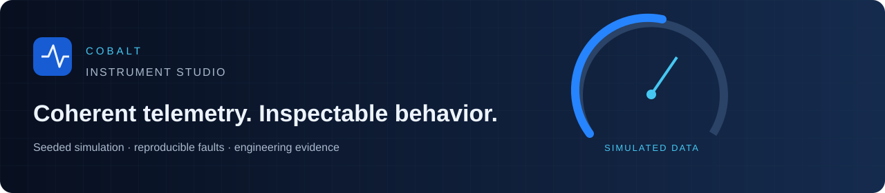
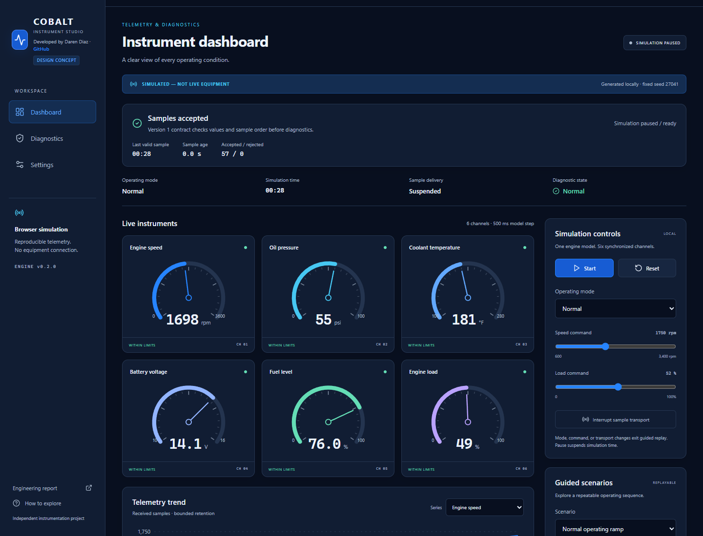
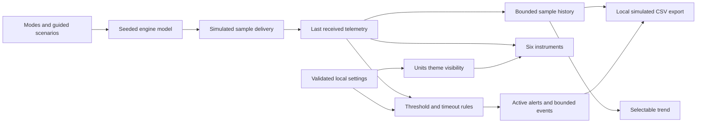

# Cobalt Instrument Studio

_Developed by Daren Diaz_

An original industrial telemetry simulator built to make operating behavior inspectable. One seeded engine model drives six instruments, a live trend, and diagnostic state transitions. Reproducible faults show what changed, what triggered an alert, and how it recovered.

**SIMULATED — NOT LIVE EQUIPMENT.** This project has no equipment connection, hardware driver, backend, safety control, or production certification.



## Explore the project

Open the [live Netlify demo](https://cobalt-instrument-studio.netlify.app/) or the independent [GitHub Pages backup](https://cloudwizardboricua.github.io/cobalt-instrument-studio/). The [public source repository](https://github.com/CloudWizardBoricua/cobalt-instrument-studio) uses `main` as its default branch. Both sites serve static assets and run the simulation in your browser.

Start the simulation, choose Idle, Normal, High Load, or Fault, and adjust speed/load commands. Pause freezes simulation time; Reset creates a fresh session. The guided scenarios use seed `27041`:

- **Normal operating ramp:** moves from idle to normal speed and load while oil pressure follows and temperature responds slowly.
- **Coolant overheat:** introduces cooling degradation at 6 simulated seconds. With defaults, coolant warning begins at 14 s and critical at 18.5 s.
- **Communication loss:** stops delivered samples at 5 s, marks stale data at 6.5 s, and restores delivery at 17 s. The last received values remain visible; the trend leaves a gap across missing samples.

Open Diagnostics to inspect trigger reasons, acknowledge alerts, and review recovery events. Acknowledgment records review and does not clear a continuing condition. A severity escalation requires another acknowledgment. Reset clears the session; automatic recovery clears its active alert.

## Implemented capabilities

- Six synchronized SVG gauges for RPM, oil pressure, coolant temperature, battery voltage, fuel level, and engine load.
- A fixed 500 ms simulation step, seeded disturbances, bounded values, and defined relationships between channels.
- A selectable Recharts trend retaining at most 240 received samples and an event log retaining at most 100 entries.
- Upper/lower thresholds, validated ordering and ranges, hysteresis, configurable sample debounce, deduplicated alerts, and sample timeout recovery.
- Dashboard, Diagnostics, and Settings views with responsive layout, day/night appearance, metric/imperial display, and gauge visibility preferences.
- Validated, versioned LocalStorage preferences with fallback when storage is unavailable. No telemetry or event persistence.
- An engineering evidence panel and local CSV downloads explicitly labeled as simulated.
- PDF/DOCX reports, real desktop/mobile screenshots, tests, passing remote CI, and two verified public static deployments.

## Run and validate

Requires Node.js 24 and npm. Install packages only inside this project.

```sh
npm ci
npm run dev
npm run typecheck
npm test
npm run test:e2e
npm run verify:privacy
npm run build
npm run build:pages
```

On Windows PowerShell, use `npm.cmd` if the script execution policy blocks `npm.ps1`. Local browser tests use installed Microsoft Edge by default. Set `PW_BROWSER_CHANNEL=chrome` to use installed Chrome. CI installs Playwright Chromium and uses it without a channel override. The dev/preview servers are local testing tools; the deployed app requires only static assets and visitor-side JavaScript.

`npm run build` creates root assets in `dist`. `npm run build:pages` creates `/cobalt-instrument-studio/` assets in `dist-pages`. Both synchronize the reports into site download folders. Navigation uses view state, so production refresh stays on one HTML entry point.

## Architecture



The pure engine and diagnostic modules are under `src/engine`; UI components consume one typed reducer state. Fixed simulation time preserves exact seeded replay when browser scheduling varies. Timeout age uses simulation time and stops when paused. It does not measure a real communications link or wall-clock service availability.

Temperature has first-order inertia. Oil pressure rises with speed and weakens under high coolant temperature. Charging voltage follows speed or fault state. Fuel declines monotonically with load. These are engineered demonstration assumptions, not calibrated machinery equations. Fault thermal response is deliberately accelerated for inspection.

## Validation evidence

The current verified baseline is **32 unit tests and 7 browser tests passing** on local Windows with Microsoft Edge and separately in [GitHub Actions on Linux with Chromium](https://github.com/CloudWizardBoricua/cobalt-instrument-studio/actions/runs/38331306537). The suite covers normal/fault/recovery paths, pause/reset, seeded replay, limits, persistence, CSV download, and 1440 px desktop / 390 px mobile layouts. Guided browser tests use a controlled clock; a separate real-time smoke check verifies visible updates and pause behavior. Exact observations are in [validation evidence](docs/validation-evidence.json) and the engineering report.

The [Pages deployment workflow](https://github.com/CloudWizardBoricua/cobalt-instrument-studio/actions/runs/38331306485) also passed. Anonymous HTTPS checks verified both public HTML entries, referenced assets, source links, the observed README, and PDF/DOCX downloads whose bytes matched the local reports. Live production checks passed on both origins: six changing instruments, mode and speed/load controls, Start/Pause/Reset, normal replay, overheat acknowledgment, and communication timeout/recovery. All three views fit a 390 px mobile viewport without horizontal overflow; observed error-level console logs were empty. Exact results are in [public browser validation](docs/public-browser-validation.json) and [public HTTP validation](docs/public-http-validation.json). No physical cellular-network check, heap-memory benchmark, frame-rate benchmark, long-duration browser soak, Safari/Firefox result, hardware measurement, or public uptime measurement is claimed. The privacy script checks text; binary metadata and screenshots require separate inspection.

## Current demo and hypothetical production system

| Area          | Implemented simulator                        | Future production requirement                                                                |
| ------------- | -------------------------------------------- | -------------------------------------------------------------------------------------------- |
| Inputs        | One generated browser model                  | Validated device/gateway adapter and telemetry schema                                        |
| Communication | Deterministic loss and timeout replay        | Real timestamps, sequence numbers, retries, integrity checks, and network testing            |
| Safety        | Display and simulation controls only         | Separate hazard analysis, safety controls, hardware validation, and applicable certification |
| Security      | No login, backend, equipment, or credentials | Device authentication, authorization, credential lifecycle, and system isolation             |
| Logs          | Bounded memory and local CSV export          | Durable storage, retention, integrity, access controls, and audit trails                     |
| Reliability   | Local and remote unit/browser checks         | Cross-browser testing, hardware in the loop, soak tests, monitoring, and rollback            |

CAN/J1939 is a hypothetical future interface only. Generic applications could include generator instrumentation training, fleet diagnostic workflow evaluation, and pump/motor condition-display prototyping. Equipment-specific thresholds and software behavior would need independent validation before real use.

## Reports and future work

- [Engineering report PDF](docs/Cobalt_Engineering_Report.pdf)
- [Editable engineering report DOCX](docs/Cobalt_Engineering_Report.docx)
- [15 prioritized future improvements](docs/ROADMAP.md)
- [Verified hosting and cellular inspection](docs/DEPLOYMENT.md)
- [Changelog](CHANGELOG.md)

The report source and builder are in `docs/report-source.json` and `scripts/build-report.py`. Report generation uses Python document tools and is separate from site operation. Version **0.1.0** is published to both sites and as one [GitHub Release](https://github.com/CloudWizardBoricua/cobalt-instrument-studio/releases/tag/v0.1.0). The [annotated tag source](https://github.com/CloudWizardBoricua/cobalt-instrument-studio/tree/v0.1.0) identifies the reviewed version. The [release workflow](https://github.com/CloudWizardBoricua/cobalt-instrument-studio/actions/runs/38331500958) passed 32 unit tests and 7 browser tests before creating that release. Its PDF and DOCX attachments each contain seven visually checked pages; anonymous downloads matched the local artifacts, and release notes matched the reviewed notes. [Release validation](docs/release-validation.json) records these checks.

The reports are also available directly from the hosted builds: [Netlify PDF](https://cobalt-instrument-studio.netlify.app/reports/Cobalt_Engineering_Report.pdf), [Netlify DOCX](https://cobalt-instrument-studio.netlify.app/reports/Cobalt_Engineering_Report.docx), [Pages PDF](https://cloudwizardboricua.github.io/cobalt-instrument-studio/reports/Cobalt_Engineering_Report.pdf), and [Pages DOCX](https://cloudwizardboricua.github.io/cobalt-instrument-studio/reports/Cobalt_Engineering_Report.docx).

React, TypeScript, Vite, Recharts, Lucide, and Vitest provide the implementation stack. No project license has been selected; third-party dependencies retain their own licenses.
