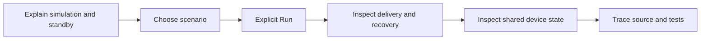
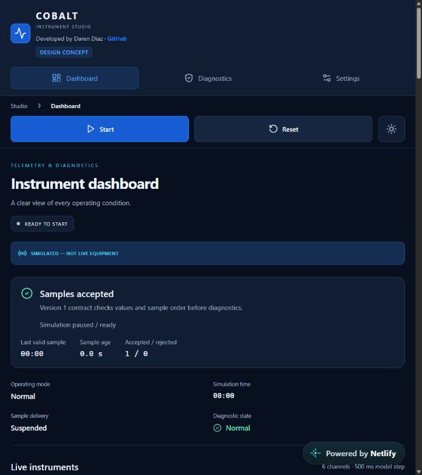
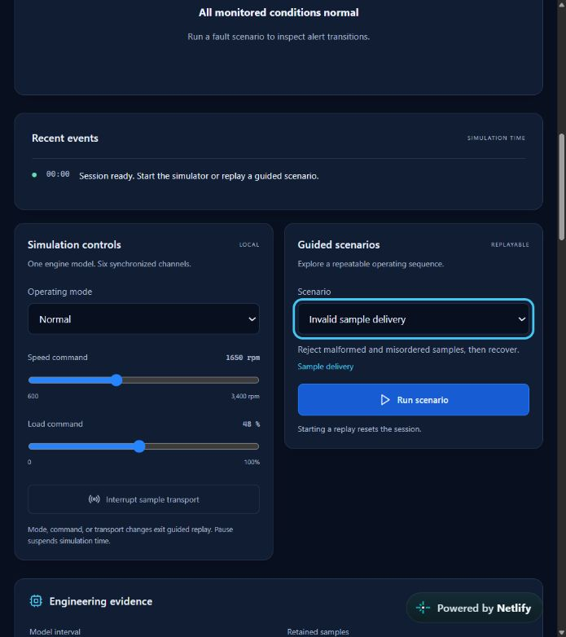
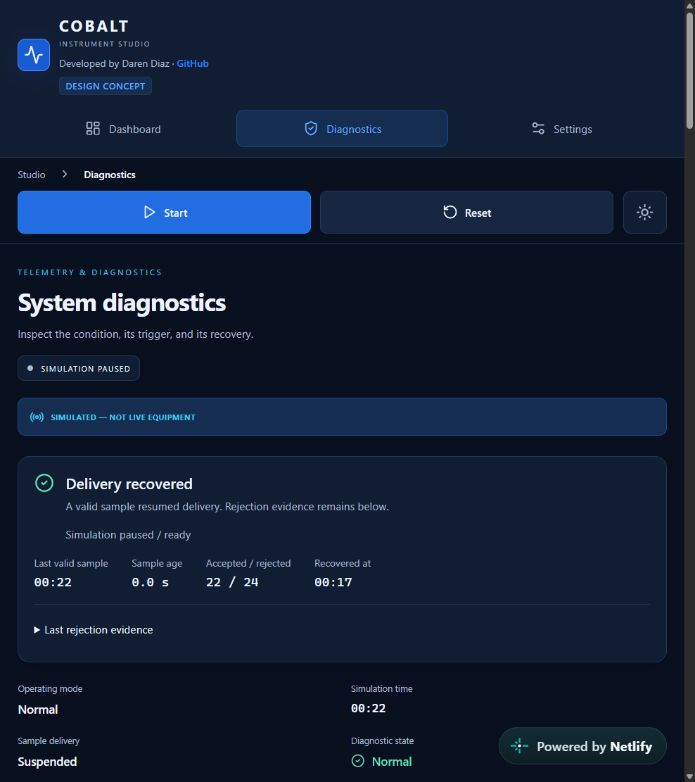
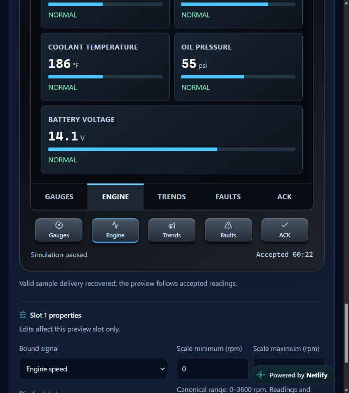
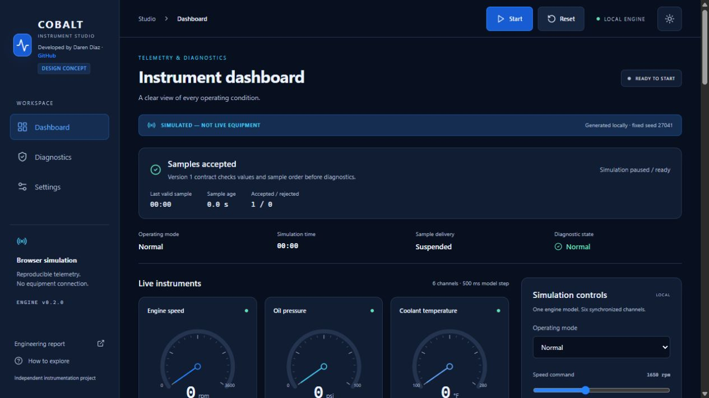

# Demo usability and presentation review

Fall 2026 · Product Design audit · Existing public simulator, preserved behavior

## Scope and evidence

Goal: help a presenter unfamiliar with this code explain simulated measurements, delivery quality, alarm review and display editing to an audience unfamiliar with HMIs. Fresh in-app-browser captures were saved, reopened and visually inspected during this sprint. Netlify was observed in the narrow app panel; Pages was observed in a desktop viewport. These different viewports are observations, not a side-by-side fidelity comparison.

No application redesign was applied. Findings within scope are addressed through the presenter walkthrough, file naming, comments and repository navigation. Visual/interface changes below remain recommendations.

## Captured walkthrough

1. **Opening standby.** The shared Start/Reset controls and simulated-data notice give a clear entry. The initial “Samples accepted” count is 1 while gauges are placeholders: explain the initialized sample versus the zero presentation before starting.

   

2. **Scenario draft.** In Diagnostics, choosing Invalid sample delivery changes the description but does not start a replay. Run scenario is explicit, with a reset warning and visible keyboard focus. This supports a predictable live demonstration. On the narrow layout, finding these controls requires scrolling.

   

3. **Recovery and retained evidence.** After Run and automatic recovery, Pause held the session at 00:22. The screen showed Delivery recovered, 22 accepted / 24 rejected attempts, recovery at 00:17, and retained rejection details. The accessibility tree also exposed rejection and timeout/recovery events. This capture demonstrates the recovered state; it does not itself show every intermediate rejected frame.

   

4. **Device preview.** The Engine tab and its matching softkey selected the same page. Held accepted readings and a paused status remained visible beside display properties. This image is an intentional scrolled viewport excerpt of the review controls and editor, not a full-device screenshot. The numerical values are simulated.

   

5. **Independent public backup.** Pages loaded the expected desktop dashboard, simulation notice, standby status and shared session controls at the existing project-base URL.

   

## Findings and scoped response

| Priority | Evidence and implication | Response |
| --- | --- | --- |
| P2: terminology | The opening dashboard uses “Live instruments” beneath a simulated-data banner. A newcomer could read “live” as connected equipment. | Presenter guide explicitly says values are generated locally. Recommend a separately reviewed copy change to “Simulated instruments”; left unchanged to preserve the application in this cleanup. |
| P2: standby interpretation | “Samples accepted: 1” appears before visible gauge activity. The engine initializes a sample while the display intentionally waits for Start. | Source/test comments and walkthrough explain the distinction. Recommend separately evaluating standby-specific quality wording. |
| P3: discoverability | Guided scenarios and the workspace require scrolling in the narrow panel; duplicate tabs/softkeys provide two ways to change preview pages. | The walkthrough gives an explicit scroll/order cue and explains the shared selection. No navigation restructuring was needed. |
| P3: evidence visibility | The Netlify provider badge overlays a small portion of the lower-right viewport. | Record it as provider UI and choose a wider presentation viewport; provider settings were not changed. |
| Strength | Persistent top session controls, explicit Run/reset language, textual quality cues, retained rejection reasons and ACK explanations make state transitions explainable. | Preserve these cues and trace them to the central reducer during the demo. |

## Accessibility observations and limits

Visible focus, labeled controls, textual quality/severity and accessible tab/softkey state were observed. Existing browser tests separately exercise keyboard paths, announcements, contrast calculations, reduced motion and responsive layouts. Screenshots and an accessibility tree do not establish full screen-reader compatibility, WCAG conformance, physical touch-target usability or readability on an industrial panel. No assistive-technology or actual equipment session was performed.

The fresh local suite passed 17 browser tests and both static hosting bases; see [validation](DEMO_VALIDATION.md). The public browser observation was narrower and is not a rerun of all 17 tests on each live origin. Pages has baseline deployment-workflow evidence; Netlify's exact provider source revision remains unverified. Both public sites retain their existing behavior and URLs.

For the demo, begin with [DEMO_WALKTHROUGH.md](DEMO_WALKTHROUGH.md), then use the [source guide](../src/README.md) and [test map](TEST_RELEVANCE.md). A production HMI still needs qualified acquisition, independent freshness/alarm timing, durable records and authenticated operations.
