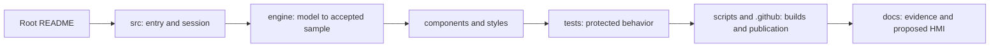

# Presenter walkthrough

Fall 2026 · Static simulator v0.2.0 · Repository polishing branch

## Prepare once

Use Node 24 and run commands from the repository root. On Windows, use `npm.cmd` when PowerShell policy blocks `npm.ps1`.

```sh
npm ci
npm run typecheck
npm run verify:paths
npm run test:ci
npm run dev
```

Open the local Vite address printed in the terminal. The [Netlify demo](https://cobalt-instrument-studio.netlify.app/) and [Pages backup](https://cloudwizardboricua.github.io/cobalt-instrument-studio/) show the existing hosted versions, not this unpushed branch. Pages has fresh main-workflow evidence; the exact current Netlify source revision remains unverified. Keep the backup ready; confirm public access before presenting. Use a fresh browser context or restore default settings so earlier saved thresholds/visibility do not change the story. See [validation](DEMO_VALIDATION.md) for actual checks and limitations.

## A six-minute demonstration

1. **Set the boundary (30 seconds).** Say: “An HMI is a human-machine interface: the screen helps an operator understand equipment conditions. Cobalt is a browser simulation, with no equipment connection or safety control.” Point to the simulated-data notice and ready/standby state. Zero readouts are placeholders; the initialized accepted sample still exists internally.
2. **Start, pause, reset (45 seconds).** Start from the top toolbar, watch the six values change, then pause. Explain that this freezes simulation time and sample-age evaluation. Reset returns the display to standby. A production acquisition service must continue independently of the browser.
3. **Show a repeatable fault (90 seconds).** Select Coolant overheat under Guided scenarios, then Run scenario. Selection alone is a draft. Run resets the session with seed `27041`; degradation begins at 6 simulation seconds. Open Diagnostics as the condition moves through warning/critical. Acknowledge it: review does not repair the condition, and escalation requires renewed review.
4. **Separate process from delivery (60 seconds).** Run Invalid sample delivery. From 5 through 16.5 seconds, invalid attempts cannot replace accepted readings or refresh age. A 2-second default timeout makes the held readings stale; accepted delivery resumes at 17 seconds. Point to rejection reasons, counters and recovery evidence. These are simulated quality checks, not proof of hardware integrity.
5. **Explain the device workspace (60 seconds).** Scroll to the default-open workspace. Visit Engine, Trends, Faults and ACK; the same session feeds every page. Select a slot, edit its label or display range, and Apply. Display configuration does not change samples or alarm rules. Layouts are session-only; settings persist locally when storage permits.
6. **Export and tour the source (75 seconds).** Export simulated CSV or open a report. Reports are frozen engineering artifacts, separate from the current session. Navigate the repository in the order below and close with what an industrial deployment would still require.

## Repository navigation order



| Stop | Explain |
| --- | --- |
| [Root README](../README.md) | Main navigation, run commands and implemented versus proposed boundaries. |
| [Source guide](../src/README.md), [App](../src/App.tsx) | One reducer owns session state; one interval advances fixed model steps. |
| [Engine guide](../src/engine/README.md) | `simulation → telemetry validation → diagnostics → studio history`. Catalog names describe presentation; they are not hardware drivers. |
| [Components](../src/components/README.md), [styles](../src/styles/README.md) | Reuse accepted samples; preview drafts stay separate from model and alarm thresholds. |
| [Test guide](../tests/README.md), [assessment](TEST_RELEVANCE.md) | Why every test remains; portable fixture fix; browser tests are simulator evidence. |
| [Scripts](../scripts/README.md), [automation](../.github/README.md) | Root and Pages builds; exact CI artifact publication; Netlify's independent rebuild. |
| [Evidence index](README.md), [repository audit](REPOSITORY_AUDIT.md) | Current branch/PR facts versus historical release receipts. |
| [HMI architecture](HMI_ARCHITECTURE.md), [roadmap](ROADMAP.md) | Future gateway, durable alarms, roles and hardware qualification. These are proposals. |

## Useful explanations and recovery

- **Telemetry:** measured-looking values generated by the seeded engine here. Canonical units are rpm, psi, degrees F, volts and percent; metric units are display conversion.
- **Debounce:** require repeated accepted samples before a threshold transition. **Hysteresis:** recover past a margin to reduce boundary chatter. Neither is a hardware safety interlock.
- **Stale:** no sufficiently recent accepted sample. **Rejected:** an attempted sample failed the contract. A stream can be both rejected and stale.
- **ACK:** records review; it does not clear an ongoing fault. Event records are bounded browser memory, not an authenticated durable industrial log.
- **Unexpected demo state:** restore defaults in Settings, return to Dashboard, Reset, then Run the named scenario. A page reload discards layout/history/events but can reload saved preferences.
- **No network:** run the already installed local project. Static hosting is an alternative, not a requirement for simulation. A local demonstration does not prove installed offline HMI startup.

Full validation sequence and hosting checks are in [DEMO_VALIDATION.md](DEMO_VALIDATION.md). The [polishing plan](DEMO_POLISH_PLAN.md) contains the before/after tree and complete rename mapping.
