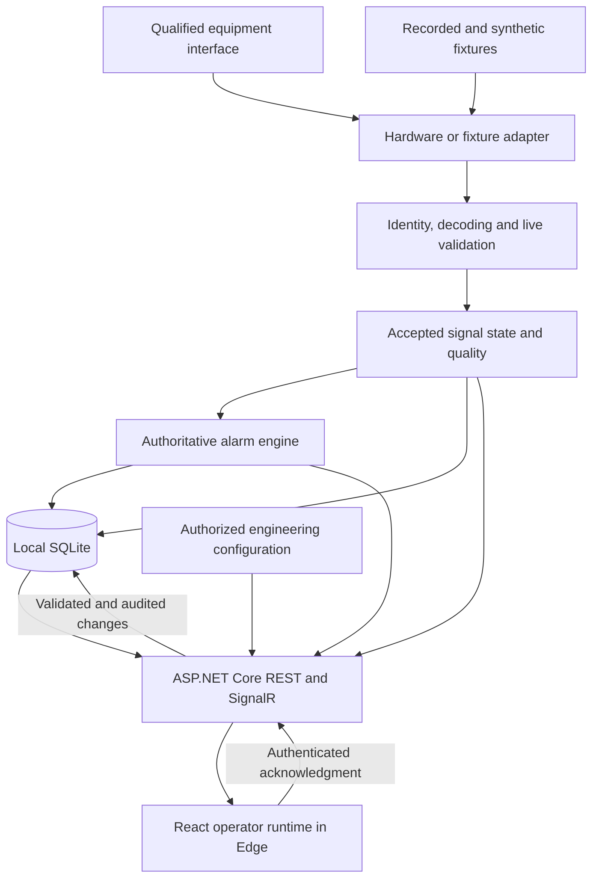

# Proposed HMI product architecture

_Developed by Daren Diaz_ · [GitHub repository](https://github.com/CloudWizardBoricua/cobalt-instrument-studio)

Fall 2026 · **PROPOSED — not implemented**

**SIMULATED — NOT LIVE EQUIPMENT.** The current repository is a React/TypeScript browser simulator. It has no backend, equipment driver, authentication service, durable alarm store, or qualified industrial runtime. This document describes the intended product architecture; its services and interfaces are design requirements, not available commands or APIs.

The first product will monitor equipment and record operator acknowledgments on an industrial PC (IPC), with offline operation. Windows and Microsoft Edge are the first qualification target. Linux is a later port with its own driver, installation, browser, and recovery evidence. Equipment control, safety functions, cloud fleet management, and arbitrary protocol support are outside the first product.

## System architecture

Keep the existing React, TypeScript, and Vite frontend. Add a single local C# service using .NET 10 LTS, ASP.NET Core, `BackgroundService` workers, REST, SignalR, and SQLite. The service hosts the built frontend and its APIs on the same origin. Acquisition, alarms, and storage continue independently of browser tabs or connectivity.

| Subsystem | Proposed responsibility |
| --- | --- |
| Acquisition worker | Own driver lifecycle, receive/decode data, track source health, and submit bounded validated updates. |
| Live domain and alarm engine | Own signal quality, freshness, alarm transitions, and acknowledgment rules without depending on React or SignalR. |
| Application/API layer | Authorize reads and writes, coordinate durable transactions, expose snapshots/history, and publish committed state. |
| Persistence layer | Store device/configuration versions, alarms, acknowledgments, audit records, and bounded telemetry history. |
| React runtime | Present authoritative state, connection quality, trends, alarms, and acknowledged outcomes. |
| Engineering workspace | Edit validated layouts and configuration with explicit apply, revision checks, permissions, and audit. |

Use one deployable service initially; separate internal modules and interfaces rather than introducing distributed services. No message broker, external identity provider, cloud database, or internet connection is required for local operation. The hardware adapter is replaceable without changing the browser contract.

.NET 10 is an LTS release; pin the SDK and maintained package versions during implementation and keep servicing updates current. See the [.NET support policy](https://dotnet.microsoft.com/en-us/platform/support/policy/dotnet-core). SignalR provides server-to-client delivery, but application recovery and durability still belong to this design. See the [SignalR overview](https://learn.microsoft.com/en-us/aspnet/core/signalr/introduction?view=aspnetcore-10.0).

## Frontend and source separation

The current [studio reducer](../src/engine/studio-state.ts) owns simulation time, received samples, diagnostics, and history. Preserve this deterministic demonstration behavior behind a simulator source. Introduce a separate live source that receives server-owned state and submits authorized application operations.

- Select simulator or live mode explicitly at startup and display the active source/device identity persistently. A failed live connection must never activate generated data.
- Keep presentation components independent of the simulator's `running`, `mode`, and target controls. Simulator Start/Pause/Reset and fault injection remain demonstration tools.
- In live mode, initial values are unavailable until accepted data arrives. A lost connection retains clearly marked last-known values with age and quality; zero is not a substitute for missing measurements.
- A live trend freeze affects presentation only. It cannot pause acquisition, freshness, alarm processing, or audit records.
- Separate the operator screen from engineering editing. An operator can inspect and acknowledge alarms; engineering users can change permitted configuration through reviewed, atomic transactions.
- Keep display preferences such as theme and units local where appropriate. Device bindings, alarm policies, and deployed layouts are server-owned, versioned configuration.
- Preserve numeric readings when a display needle clamps. Keep data quality, alarm severity, communication health, and display-range exceptions visibly distinct.
- Render at a bounded cadence, initially matching the existing 500 ms display cadence. Ingestion and alarm evaluation follow qualified equipment requirements and never depend on chart refresh frequency.

Retain the current visual identity and reusable gauges, trends, and device pages. Qualify touch targets, focus order, zoom, keyboard operation, screen-reader announcements, and readability on the actual IPC display. A browser viewport test alone does not qualify industrial hardware.

## Live telemetry contract

The existing [telemetry contract](TELEMETRY_CONTRACT.md) remains the simulator v1 contract. Its simulation clock, six complete fields, and demonstration bounds must not be relabeled as a field-equipment contract. Define a separately versioned live contract and shared fixtures before implementing transport.

| Contract concern | Proposed rule |
| --- | --- |
| Identity | Identify gateway, equipment/device, and signal using stable configured identifiers. Validate identity before merging state. |
| Stream ordering | Identify a source session/epoch and sequence. Deduplicate within that stream; a qualified restart establishes a new epoch. |
| Time | Preserve source measurement time when supplied, receiver UTC time for audit, and monotonic elapsed time for local watchdogs. Record clock quality. |
| Values and units | Decode protocol status, scaling, calibration, and native units before converting to declared canonical units. Version metadata and calibration references. |
| Partial updates | Accept independently updated signals without refreshing the age of untouched signals. Track quality and freshness per signal. |
| Quality | Distinguish unavailable, invalid, stale, and accepted current data. A valid dangerous measurement must reach alarm evaluation. |
| Compatibility | Negotiate supported contract/configuration versions explicitly. Reject unsupported payloads with bounded diagnostic evidence. |

Only accepted values may replace the last accepted measurement, append measurement history, or advance threshold evaluation. Invalid attempts can update health/rejection evidence but cannot refresh a value's age. Preserve the current owned-copy validation principle; never retain arbitrary incoming payload references.

Do not use browser time for equipment freshness. A source timestamp alone cannot establish freshness when the device clock is unsynchronized. The adapter must declare its timing capability and qualified age policy. Use monotonic receiver deadlines for communication detection while preserving source age where trustworthy; delayed buffered values must not appear current simply because they just arrived.

The browser also needs a separate elapsed-time watchdog for gateway/stream silence. This measures client-to-gateway health, not authoritative equipment age. Mark the connection and retained data as unconfirmed after silence or a suspended tab resumes, even if SignalR has not reported a disconnect; restore current status only after snapshot/event reconciliation. An old server-reported freshness flag must not remain apparently current indefinitely.

Sequence rollover, source restart, out-of-order delivery, repeated samples, missing channels, and clock corrections need fixture coverage. Reconnect does not authorize unknown identities or reset ordering indiscriminately. Old-epoch packets must not overwrite a newer equipment session.

Demonstration plausibility limits are not production rejection limits. Equipment-specific validation must distinguish a sensor error/status code from a valid out-of-range process condition. Alarm thresholds, display ranges, and physical validity bounds remain separate concepts.

## Alarms and acknowledgments

The local service is the single alarm authority. Reuse the existing hysteresis, accepted-data isolation, and escalation semantics as test references, then qualify timing and thresholds for the selected equipment. Preserve simulator tests unchanged while adding C# tests against common language-neutral fixtures.

- An alarm has a stable device/signal identity, a durable occurrence identity, and a revision that changes on relevant lifecycle transitions.
- Acknowledgment records the authenticated actor, server time, exact alarm occurrence/revision, and request identity. It records review; it does not clear a continuing condition or write to equipment.
- Commit acknowledgment and its audit event atomically before reporting success. Retried requests return the existing result instead of creating duplicate acknowledgment events.
- Reject an acknowledgment against an obsolete revision and return current state. An escalation requires a fresh acknowledgment and cannot be acknowledged accidentally by a delayed request.
- Evaluate live debounce using qualified elapsed-time/cadence policy. The simulator's sample-count debounce remains valid for its fixed-step demonstration only.
- Communication loss and invalid-data evidence may coexist with a retained process alarm. Loss of data does not establish recovery.
- Recover durable alarm state after service restart, mark measurements unavailable/stale until revalidated, and record service interruption. Do not claim continuous observation during downtime.

Display reset, navigation, browser reload, and log-out cannot erase alarm history or reset active equipment conditions. No start/stop, setpoint, PLC output, bus-transmit control, or equipment-reset operation is part of the initial API.

## Proposed application interfaces

The table below defines capabilities and subsystem responsibilities, **not runnable endpoint paths or a finalized wire schema**. Implementation must publish an OpenAPI contract for REST and a versioned event contract for SignalR with generated TypeScript types or verified schema fixtures.

| Capability | Transport and result | Access/consistency requirement |
| --- | --- | --- |
| Runtime/device discovery | REST: source mode, supported versions, device/signal metadata, and service health. | Authenticated viewer; never infer identity from a display label. |
| Current runtime snapshot | REST: accepted values/quality, active alarms, configuration revision, and stream cursor. | Coherent snapshot with a defined event boundary. |
| Live updates | SignalR: bounded measurement updates, health changes, and committed alarm/configuration events. | Authenticated subscriptions; scoped device access and ordered cursors. |
| History and audit | REST: paginated time-bounded measurements, alarm transitions, and acknowledgment records. | Bounded query ranges/results; explicit gaps and retention limits. |
| Acknowledge alarm | REST: occurrence/revision and idempotent request identity; committed outcome. | Operator or engineer; actor derived from session, never trusted from request text. |
| Configuration/layout | REST: validated read and revision-checked atomic apply. | Engineer; audit old/new revision and reject conflicting edits. |
| Session administration | REST: local sign-in, sign-out, and permitted account administration. | Server-enforced roles and session lifecycle. |

On connection, obtain a snapshot and subscribe/replay from its cursor without a lost-update window. Reconnect uses bounded backoff and a fresh authoritative snapshot when the retained cursor cannot be resumed. A connection-restored indicator alone does not establish synchronized data.

Bound acquisition, persistence, and client queues independently. Measurement broadcasts may coalesce latest accepted values for display; alarm transitions and audit events require durable storage and recoverable cursors. A slow client must not stall acquisition or grow memory indefinitely. Mark dropped measurement intervals and replay gaps explicitly.

Define maximum payload size, query limits, queue capacity, ingestion rate, display rate, and timeout budgets in the qualified device profile. Record measured limits before pilot acceptance; do not present the simulator's 2 Hz refresh as a fieldbus throughput or real-time guarantee.

## Identity, permissions, and deployment boundary

Use ASP.NET Core Identity with local accounts and cookie-based sessions so operator accountability works offline. Provision the first engineering administrator during commissioning; do not distribute shared default credentials. Hash passwords through the supported identity framework and document local account recovery.

| Role | Initial authority |
| --- | --- |
| Viewer | Read permitted device status, trends, and alarms. |
| Operator | Viewer access plus acknowledgment of current alarm revisions. |
| Engineer | Operator access plus validated configuration/layout changes and explicitly authorized administration. |

Enforce authorization on every API and SignalR operation. Hiding an editing control is not access control. Protect state-changing cookie-authenticated requests against CSRF; validate allowed origins, configure session expiry, and audit authentication/configuration failures without exposing secrets.

The first installation co-locates Edge and the service on one IPC and binds the service to loopback. Host the UI and API together. Remote access is disabled initially; enabling LAN access is a separate deployment profile requiring TLS, certificate provisioning/renewal, firewall restrictions, and its own tests.

Run the service under a dedicated least-privilege Windows account with access only to its data directory and qualified driver resources. Keep signing keys and service secrets outside the browser bundle. Restrict data/configuration file permissions. Hardware and controller safety protections remain independent of this display application.

## Persistence and failure behavior

Use SQLite through the .NET persistence layer on local, nonsynchronized storage. Do not put the live database in OneDrive, a shared network directory, or a source checkout. WAL allows concurrent readers alongside one writer and requires same-host storage; see [SQLite WAL](https://www.sqlite.org/wal.html).

- Store configuration and schema versions, equipment metadata, alarm lifecycle records, acknowledgments, and accountable configuration changes durably. Keep raw telemetry retention separately bounded by age and disk quota.
- Use a controlled writer queue and bounded batches. Record alarm/ACK transactions before advertising durable success; telemetry batching must declare its possible crash-loss window.
- Treat audit rows as append-only through application permissions. This is accountable local history, not a claim of tamper-proof or certified records.
- Configure retention during commissioning from the approved recording needs and IPC capacity. Surface impending limits before pruning telemetry; never silently discard required alarm/audit records to make room.
- Apply reviewed migrations with a verified pre-migration backup and schema compatibility check. An unsupported schema must fail visibly rather than reset the database.
- Produce consistent backups through a supported SQLite backup mechanism, verify restore in a separate location, and include required configuration/version metadata. Do not copy only an active database file and assume its WAL has been captured. See the [SQLite Backup API](https://www.sqlite.org/backup.html).
- On disk-full or database-write failure, expose degraded storage health and reject operations requiring durable success, including ACK/configuration writes. Continue live observation only while acquisition remains healthy, visibly marking recording as impaired.
- After abrupt power loss, recover committed state, check storage health, identify recording gaps, and reconnect to equipment. Qualification must measure behavior on the intended storage and power arrangement; database choice alone does not prove power-loss durability.

## Installation, operations, and updates

Package the service, matching static frontend, configuration schema, and required runtime together. Install the C# host as a supervised Windows Service with automatic startup and bounded restart policy; launch Edge in the qualified kiosk configuration. See [Windows Service hosting](https://learn.microsoft.com/en-us/dotnet/core/extensions/windows-service).

Expose health separately for process liveness, adapter connection, signal freshness, alarm processing, queue backlog, database writes, and available disk. Log structured correlation/device identifiers and actionable failure codes with bounded rotation. A healthy HTTP endpoint alone does not establish healthy equipment data.

Provide an engineer-requested support bundle containing product/schema/driver versions, redacted configuration, recent bounded logs, queue/storage health, and diagnostic summaries. Exclude credentials, session tokens, private user paths, and unnecessary personal metadata. Export is explicit; background cloud upload is not required.

Distribute signed, versioned offline-installable packages with checksums and provenance. Before upgrading, check device-profile compatibility and available storage, back up durable state, and record the current version. Verify startup, acquisition, alarm continuity, and UI compatibility after installation.

Keep the previous qualified package for rollback. A binary rollback is allowed only when its schema compatibility is verified; otherwise restore the matching tested backup as part of the documented recovery procedure. Do not replace a running installation merely because a newer build exists.

Linux support comes after Windows qualification and requires its own service supervision, file permissions, driver integration, kiosk setup, installation/update package, and recovery tests. Cross-platform .NET does not itself qualify a hardware adapter or HMI installation.

## Hardware qualification gate

The initial adapter delivers deterministic fixtures and recorded samples. Before selecting a live driver, identify one equipment family, physical interface, vendor protocol definition, SDK/license constraints, isolation requirements, signal list, scaling/status rules, update rates, and supported IPC/OS combination.

CAN/J1939, Modbus, and OPC UA are possible discovery outcomes, not implemented or selected capabilities. Do not choose a protocol solely because the demonstration resembles an engine panel. Qualify one read-only adapter before expanding protocol or device coverage.

Bench tests must establish identity, decoded values, timing, missing/invalid status, cable loss, device reboot, reconnect, and interference boundaries. Document whether the protocol requires any request traffic for monitoring; read-only means no equipment configuration/control writes, not an unsupported claim of electrical passivity.

## Validation gates and roadmap alignment

The [engineering roadmap](ROADMAP.md) defines sequencing, dependencies and implementation deliverables. The named gates below define the evidence needed to progress; no gate is satisfied by this architecture document.

| Delivery phase | Required acceptance scenarios |
| --- | --- |
| 0. Dependable baseline | Portable tests, reviewed dependency findings, and repeatable checks preserve historical captures and evidence. |
| 1. Contracts and fixture foundation | Preserve simulator v1 regressions; TypeScript/C# fixtures agree on identity, units, bounds, partial values, quality, timestamps, sequence/epoch changes, and rejection behavior. |
| 2. Local service and runtime integration | Closing/reloading Edge does not stop acquisition/alarms; initial live values are unavailable; no demo fallback; client silence/tab resume becomes unconfirmed until reconciliation; two clients converge after disconnect, cursor expiry, and slow-consumer conditions. |
| 3. Durable alarms and engineering workflows | ACK retries are idempotent; stale-revision ACK cannot acknowledge escalation; role checks and CSRF protections hold; restart preserves committed audit; conflicting configuration apply fails without partial changes. |
| 4. Hardware and Windows IPC qualification | One driver passes scaling/status, jitter, loss, corruption, reboot, and reconnect tests; real IPC touch/keyboard/accessibility checks pass; latency/resource/retention budgets are measured. |
| 5. Pilot and release operations | Sustained operation, storage pressure, disk-full, process crash, abrupt power loss, backup/restore, signed installation/update, rollback, and redacted support export have retained evidence. |

Qualification must use the actual operating environment and a documented acceptance profile. Browser timing, a passing unit suite, or a deterministic fixture does not establish equipment calibration, functional safety, certification, availability, or a real-time guarantee.
