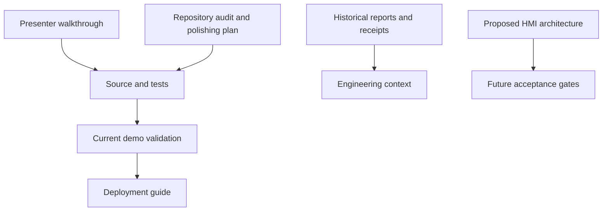

# Documentation and evidence

Start with the [presenter walkthrough](DEMO_WALKTHROUGH.md), then follow the links into [source](../src/README.md), [tests](../tests/README.md) and [delivery](DEPLOYMENT.md). This directory keeps current guides beside retained historical engineering/report evidence. A receipt proves its recorded checkpoint, not every later revision. [Repository home](../README.md)



```text
docs/
├── README.md                           # This index and evidence boundaries
├── assets/                             # Retained diagrams/screenshots; see its README
├── Cobalt_Engineering_Report.docx       # Frozen v0.2.0 editable report
├── Cobalt_Engineering_Report.pdf        # Frozen v0.2.0 nine-page report
├── DEMO_POLISH_PLAN.md                  # Pre-implementation audit, naming and moves
├── DEMO_USABILITY.md                    # Fresh Product Design flow observations
├── DEMO_VALIDATION.md                   # This sprint's actual commands/results/limits
├── DEMO_WALKTHROUGH.md                  # Presenter route through UI and code
├── DEPLOYMENT.md                        # Hosting contracts plus historical receipts
├── DESIGN_QA.md                         # Retained earlier device design verification
├── DEVOPS_HANDOFF.md                    # Historical release/delivery handoff
├── HANDOFF.md                           # Earlier application hardening checkpoint
├── HMI_ARCHITECTURE.md                  # Proposed industrial-PC product; unimplemented
├── OPEN_PR_REVIEW.md                    # Earlier nine-PR release-time review
├── RELEASE_NOTES.md                     # Frozen v0.2.0 release input
├── REPOSITORY_AUDIT.md                  # Fresh synchronization, PR and hosted-CI audit
├── ROADMAP.md                           # Dependency-ordered future product phases
├── SECURITY_REVIEW.md                   # Current source-backed security review
├── TELEMETRY_CONTRACT.md                # Current simulator envelope/acceptance boundary
├── TEST_RELEVANCE.md                    # Every maintained TypeScript test's role
├── attribution-validation.json         # Retained attribution/content observations
├── demo-polish-validation.json          # Fresh sanitized sprint results and public-byte observations
├── devops-local-validation.json        # Earlier local automation checks
├── hosting-build-validation.json       # Retained local two-base browser/report checks
├── open-pr-review.json                 # Earlier immutable dependency-PR evidence
├── public-browser-validation.json      # Earlier public browser observations
├── public-http-validation.json         # Earlier public HTTP/asset/report observations
├── release-validation.json             # Earlier release-package validation
├── report-source.json                  # Shared frozen PDF/DOCX content and checkpoint
├── v020-local-validation.json          # v0.2.0 local checkpoint
├── v020-main-ci-validation.json        # v0.2.0 actual main-CI artifact inspection
├── v020-pr-final-validation.json       # v0.2.0 final PR-CI artifact inspection
├── v020-pr-validation.json             # v0.2.0 earlier PR-CI observations
├── v020-production-browser.json        # v0.2.0 public browser observations
├── v020-production-validation.json     # v0.2.0 provider/assets/report-byte observations
├── v020-release-validation.json        # v0.2.0 tag, assets and archive inspection
├── validation-evidence.json            # Earlier integrated local application evidence
├── workflow-governance-validation.json # Earlier branch-protection/governance observation
├── workflow-pr-validation.json         # Earlier workflow PR checks
├── workflow-production-browser.json    # Earlier workflow-sprint public browser checks
├── workflow-production-validation.json # Earlier workflow-sprint provider/asset checks
└── workflow-remote-baseline.json        # Original hosted baseline and limitations
```

## Choose a reading route

| Goal | Read |
| --- | --- |
| Present in a few minutes | [Walkthrough](DEMO_WALKTHROUGH.md), [usability observations](DEMO_USABILITY.md) |
| Review this cleanup | [Plan/rename map](DEMO_POLISH_PLAN.md), [audit](REPOSITORY_AUDIT.md), [validation](DEMO_VALIDATION.md) |
| Explain accepted readings and alarms | [Telemetry contract](TELEMETRY_CONTRACT.md), [engine guide](../src/engine/README.md), [test assessment](TEST_RELEVANCE.md) |
| Explain delivery boundaries | [Deployment](DEPLOYMENT.md), [workflow guide](../.github/workflows/README.md), [security review](SECURITY_REVIEW.md) |
| Explain future industrial work | [Proposed architecture](HMI_ARCHITECTURE.md), [roadmap](ROADMAP.md) |
| Inspect earlier release proof | [Release notes](RELEASE_NOTES.md), [DevOps handoff](DEVOPS_HANDOFF.md), corresponding named JSON receipts |

The engineering report is built from `report-source.json` and selected assets, then copied by `scripts/sync-reports.mjs` to [public report downloads](../public/reports/README.md). Its binaries and historical receipts stay at their reviewed checkpoints during this cleanup. Do not regenerate them merely because comments or filenames changed. The older design QA, PR review and handoffs likewise retain historical claims; use the fresh audit/validation for this sprint.

From the project root, use `npm run typecheck`, `npm test`, `npm run verify:workflows`, `npm run verify:privacy`, both build commands and the browser/static commands listed in [validation](DEMO_VALIDATION.md). `npm run verify:static -- --skip-build` and browser tests can regenerate committed evidence paths; inspect and deliberately retain or restore those captures. `python scripts/build-report.py` is an editorial report-generation task with additional Python/rendering dependencies, not a prerequisite for presenting the unchanged reports.

Demo talking point: HMI means human-machine interface. This application demonstrates how a person can inspect simulated measurements, their freshness and alarm transitions. It has no connected equipment. The local C# gateway, authentication, persistence and qualified industrial runtime in the architecture are proposed future work. Automated tests and screenshots do not prove a physical installation safe.
