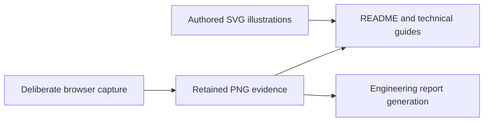

# Engineering diagrams and retained captures

These assets illustrate the simulator and its historical verification checkpoints in the root README, engineering reports and technical guides. They are documentation resources, not live telemetry or source code. [Documentation index](../README.md)



```text
assets/
├── README.md                    # Asset roles and capture limitations
├── architecture.svg             # Simulator architecture illustration
├── banner.svg                   # Project visual identity
├── dashboard-desktop.png        # Earlier desktop instrument dashboard capture
├── dashboard-mobile.png         # Earlier phone-width dashboard capture
├── device-cockpit-ack.png        # Device acknowledgment preview page
├── device-cockpit-engine.png     # Device Engine preview page
├── device-cockpit-faults.png     # Device fault-list preview page
├── device-cockpit-gauges.png     # Device gauges preview page
├── device-cockpit-mobile.png     # Narrow device/standby preview
├── device-cockpit-trends.png     # Accepted-history trend preview page
├── demo-audit-start.png          # Fresh narrow Netlify standby observation
├── demo-audit-scenario.png       # Fresh explicit scenario draft and Run control
├── demo-audit-recovery.png       # Fresh recovered delivery with retained evidence
├── demo-audit-workspace.png      # Fresh Engine/softkey/property viewport excerpt
├── demo-audit-pages.png          # Fresh desktop Pages standby observation
├── device-workspace-engine.png  # Workspace and unapplied label draft
├── diagnostics-mobile.png       # Narrow diagnostics/condition evidence
├── oil-pressure-mobile.png      # Guided oil-pressure-loss evidence
├── rejected-sample-desktop.png  # Rejected telemetry/retained-values evidence
└── workspace-desktop.png        # Display properties and accepted-data workspace
```

The [component guide](../../src/components/README.md) explains the rendered surfaces; [DESIGN_QA.md](../DESIGN_QA.md) describes the earlier device-page comparison and its limitations. New Product Design observations belong in [DEMO_USABILITY.md](../DEMO_USABILITY.md), with their own fresh captures, instead of silently replacing the old report images.

From the project root, `npm run test:e2e` captures selected screens and measurements and `npm run verify:static -- --skip-build` exercises the two completed builds. These commands can overwrite approved PNG paths. Review generated images before deliberately updating documentation; a test pass does not automatically justify replacing historical evidence. `npm run verify:privacy` checks text but cannot establish the privacy or visual correctness of PNG contents.

Demo talking point: screenshots show what a browser rendered at a known checkpoint. The device bezel and gauges are a browser preview; they do not demonstrate firmware, hardware connectivity, touch-panel qualification or physical alarm behavior. In `device-workspace-engine.png`, the edited label is an unapplied draft.
