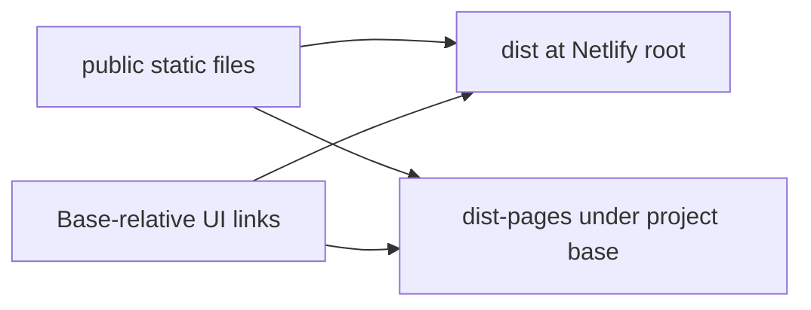

# Public static assets

Vite copies this directory's contents into each build root without changing filenames. These files are served at stable public URLs; preserve their names and relative positions. This README and the report-directory README are intentionally included as static documentation in both builds. [Repository home](../README.md) · [Deployment guide](../docs/DEPLOYMENT.md)



```text
public/
├── README.md    # Public asset guide, also copied into builds
├── favicon.svg  # Stable application icon referenced by index.html
└── reports/     # Stable PDF/DOCX download paths; see its README
```

`index.html` uses Vite's base substitution for the favicon. `EvidencePanel.tsx` uses `import.meta.env.BASE_URL` for report links, allowing `/` on Netlify and `/cobalt-instrument-studio/` on Pages without changing filenames. Do not add private source files or credentials here: everything is shipped to visitors. [Source navigation](../src/README.md) · [Report-download guide](reports/README.md)

Run from the project root:

```powershell
npm run build
npm run build:pages
npm run verify:static -- --skip-build
```

The builds first synchronize the unchanged report binaries from `docs/`; static validation checks actual downloads under both bases. Builds prove local output, not successful deployment to either provider. [Current validation](../docs/DEMO_VALIDATION.md) distinguishes those results.

Demo talking point: this HMI concept can be delivered as static files because measurements are generated inside the browser. A real industrial deployment needs the separate acquisition, authorization and operational safeguards described in the [proposed architecture](../docs/HMI_ARCHITECTURE.md).
