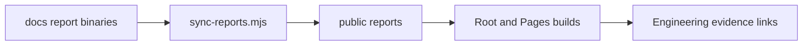

# Engineering report downloads

These reviewed PDF and DOCX binaries are public copies of the reports in `docs/`. Their existing names are download contracts used by the application, hosted checks and release packaging. This README is intentionally copied with them into both Vite builds. [Public asset guide](../README.md)



```text
reports/
├── README.md                       # Download contract and provenance guide
├── Cobalt_Engineering_Report.docx   # Reviewed editable v0.2.0 engineering report
└── Cobalt_Engineering_Report.pdf    # Reviewed nine-page v0.2.0 PDF
```

The source content/checkpoint lives in [report-source.json](../../docs/report-source.json), and [documentation assets](../../docs/assets/README.md) supply report illustrations. `scripts/sync-reports.mjs` checks the two source binaries exist and are not obviously incomplete, then copies them here before each production build. It does not regenerate document content. [Release notes](../../docs/RELEASE_NOTES.md) and [deployment guide](../../docs/DEPLOYMENT.md) explain the earlier published edition.

From the project root, `node scripts/sync-reports.mjs` refreshes copies; `npm run build` and `npm run build:pages` do this automatically. After both builds, `npm run verify:static -- --skip-build` verifies exact download bytes. Retain the reviewed binaries during comment/organization work; document regeneration and release publication are separate editorial/delivery tasks.

Existing public URLs remain `reports/Cobalt_Engineering_Report.pdf` and `reports/Cobalt_Engineering_Report.docx`, relative to each hosting base. The [current validation report](../../docs/DEMO_VALIDATION.md) records local hash/download verification and any hosted-access limits.

Demo talking point: the reports describe an explicitly simulated HMI and recorded engineering checks. Their test counts describe their historical source checkpoint; this sprint's results and future hardware integration must be explained separately.
