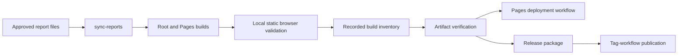

# Build, evidence and publication tools

These maintained scripts support the static browser demo. Keep their kebab-case names and directory location: npm scripts, workflows, release checks and test fixtures call these paths directly. Run commands from the repository root unless a script explicitly resolves its own root.



```text
scripts/
├── README.md                         Tools, relationships, output effects and commands
├── build-pages.mjs                   Prepare reports/types and build the Pages base
├── sync-reports.mjs                  Copy approved PDF/DOCX to public/reports
├── build-inventory.mjs               Shared static-file constraints and SHA-256 inventory
├── record-build-verification.mjs     Record completed-check identity and hashes
├── verify-build-verification.mjs     Recompute source/context/check/hash contract
├── check-pages-source.mjs            Reject superseded main sources before Pages upload
├── verify-config.mjs                 Validate workflow/action/artifact contracts
├── verify-source-paths.mjs           Check exact-case imports and filename collisions
├── verify-privacy.mjs                Check recognized private text and honest attribution
├── prepare-test-reports.mjs          Sanitize only selected retained CI JSON reports
├── validate-static-builds.mjs        Exercise both local built bases and exact downloads
├── validate-public-http.mjs          Compare explicit hosted URLs with local bytes
├── verify-release.mjs                Check version inputs and optional annotated tag
├── package-release.mjs               Round-trip tested builds; write five release assets
├── publish-release.mjs               Draft/upload/verify/publish in the tag workflow
├── collect-evidence.mjs              Refresh the full engineering evidence checkpoint
├── refresh-report-downloads.mjs      Narrow report refresh retaining prior app results
└── build-report.py                   Generate Word/PDF and the architecture illustration
```

## Routine local validation

```sh
npm run verify:workflows
npm run verify:paths
npm run verify:privacy
npm run build
npm run build:pages
npm run test:e2e
npm run verify:static -- --skip-build
```

`build` emits Netlify root assets to `dist/`. `build:pages` emits project-base assets to `dist-pages/` with `/cobalt-instrument-studio/`. Both copy the same approved report bytes before bundling. `verify:static` without `--skip-build` runs both builds itself; with the flag it verifies existing output. Its browser selection follows the local Edge/CI Chromium convention described in the [browser test guide](../tests/e2e/README.md).

Static verification writes `docs/hosting-build-validation.json`. Browser tests write tracked captures. Review these generated diffs, and do not confuse a successful local build/browser check with a deployment of the current branch. The existing [Pages workflow](../.github/workflows/deploy-pages.yml) consumes exact successful main-CI artifacts; Netlify independently rebuilds `main`. No routing rewrite is needed because navigation uses local view state.

## Read before refreshing evidence

`collect-evidence.mjs` consumes full passing unit/browser JSON, measurements and deterministic engine replay, then replaces `docs/validation-evidence.json`. It counts the currently configured test files/cases to reject filtered runs. `build-report.py` consumes that checkpoint and `docs/report-source.json`, approved screenshots and external Python/PDF tools to regenerate DOCX, PDF and an architecture asset. These are deliberate editorial workflows, not ordinary build prerequisites. The existing report checkpoint and historical receipts should remain frozen during repository polishing.

`refresh-report-downloads.mjs` copies reports into both build trees and rechecks direct downloads while retaining earlier application timing/results. Its evidence explicitly labels that narrow refresh. It cannot establish a new application test run or hosted deployment.

## Publication and trust boundaries

`record-build-verification.mjs` records hashes and check names; its caller must actually complete those checks first. `verify-build-verification.mjs` recomputes the inventory and, by default, requires a CI context. These files provide consistency within the trusted workflow/artifact boundary, not a separate attestation service.

`package-release.mjs` needs `tar`, an exact source commit, matching release inputs and an empty output directory outside the tested artifact. It validates report equality, archives both static trees, extracts them again and compares bytes before writing the manifest/checksums. Local packaging is a dry run. `publish-release.mjs` has real GitHub write capability: its CLI is restricted to the tag-triggered workflow, requires validated inputs, leaves existing public releases unchanged, and stops on an existing draft. Tests always inject a mocked HTTP transport. Do not invoke it merely to rehearse a demo.

`validate-public-http.mjs` accepts explicit stable public URLs and performs bounded anonymous reads, same-host redirect checks and local-byte comparisons. It updates the named HTTP receipt; it does not render the UI or inspect provider commit settings. Refer to [deployment documentation](../docs/DEPLOYMENT.md) for existing endpoint details and the distinction between current checks and historical receipts.

## Useful demonstration sequence

Start at `build-pages.mjs` to explain why a project-hosted URL needs a different base. Show `sync-reports.mjs` to trace stable PDF/DOCX download URLs. Then follow `build-inventory.mjs` into the verifier to explain why tested bytes should be the bytes deployed. Finish with the test-report sanitizer: useful failure evidence can be retained while recognized private strings are removed.

These tools package a simulated HMI demonstration. They do not acquire PLC/CAN/J1939/Modbus data, authenticate operators, operate machinery, provide emergency stops, or establish industrial safety compliance.

[Root navigation](../README.md) · [Tests](../tests/README.md) · [Deployment](../docs/DEPLOYMENT.md)
