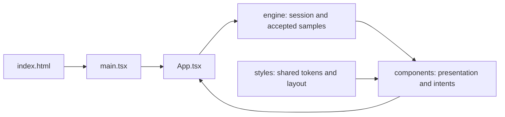

# Application source

The browser-only React HMI simulator. Start at [main.tsx](main.tsx), follow [App.tsx](App.tsx), then read the [engine guide](engine/README.md). HMI means human-machine interface: here it presents a simulated engine, with no connected equipment or safety function.



```text
src/
├── README.md       # This entry-point tour
├── main.tsx        # React mount, StrictMode and shared styles
├── App.tsx         # One session reducer, timer, views and shared workspace
├── components/     # React presentation, forms and ACK intents
├── engine/         # Pure model, validation, diagnostics and session contracts
└── styles/         # Shared studio and device-preview CSS
```

Components render the reducer's accepted sample; they do not independently acquire data. Preferences can persist in browser storage; layout/history/events remain session-only. Unit conversion changes presentation, while thresholds and telemetry retain canonical units. Pausing also freezes freshness checks; a real HMI must use independent watchdogs.

From the repository root: `npm run dev`, `npm run typecheck`, `npm run verify:paths`, `npm run test:ci`, `npm run test:e2e`. `npm run build` and `npm run build:pages` exercise the existing public bases. The entry point and report URLs remain stable.

Demo talking point: trace a Run scenario action through [studio-state.ts](engine/studio-state.ts), [simulation.ts](engine/simulation.ts), [telemetry.ts](engine/telemetry.ts), and [diagnostics.ts](engine/diagnostics.ts), then return to the displayed quality state. See the [presenter walkthrough](../docs/DEMO_WALKTHROUGH.md) and [root navigation](../README.md).
