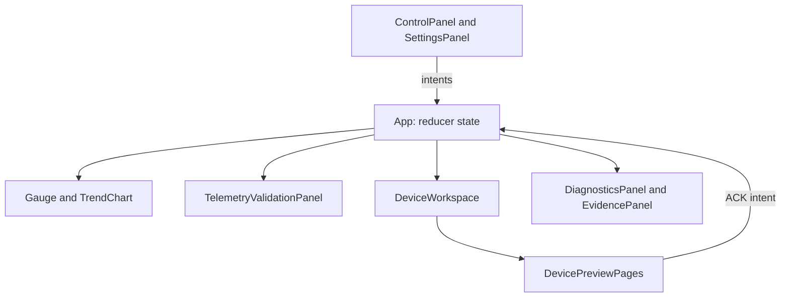

# React components

Presentation and editing surfaces consume the central accepted sample and dispatch intents. Read [App.tsx](../App.tsx) first to see ownership; [engine](../engine/README.md) evaluates simulation, telemetry and alarms. Components do not connect to hardware.



```text
components/
├── README.md                    # Presentation tour
├── ControlPanel.tsx             # Manual model commands and guided replay selection
├── DevicePreviewPages.tsx        # Gauges, Engine, Trends, Faults and ACK navigation
├── DeviceWorkspace.tsx           # Six display slots and validated Apply drafts
├── DiagnosticsPanel.tsx          # Active conditions and newest-first event history
├── EvidencePanel.tsx             # Bounded evidence, CSV and stable report links
├── Gauge.tsx                     # Numeric/SVG dashboard instrument and quality cues
├── SettingsPanel.tsx             # Local preferences and canonical-unit threshold editing
├── TelemetryValidationPanel.tsx  # Rejection, measurement age and recovery explanation
└── TrendChart.tsx                # Accepted history, display conversion and visible gaps
```

The [styles guide](../styles/README.md) explains the CSS cascade. Gauge and device dials clamp drawn geometry while preserving readings; a scale edit never changes diagnostic thresholds. ACK records review through the same reducer from either Diagnostics or the preview. Continuing conditions remain active.

Run from root: `npm run dev`, `npm run typecheck`, `npm run verify:paths`, and `npm run test:e2e`. Pure contract tests live in [tests](../../tests/README.md); browser tests cover these assembled surfaces. Build both hosting bases after any asset or report-link edit.

Demo talking points: start with shared Start/Pause/Reset, demonstrate a guided fault, then show that an unapplied slot-label draft does not alter telemetry. Explain stale versus rejected input and ACK versus recovery. For real industrial use, authenticated operations, independent acquisition, durable records and hardware qualification are future requirements.
