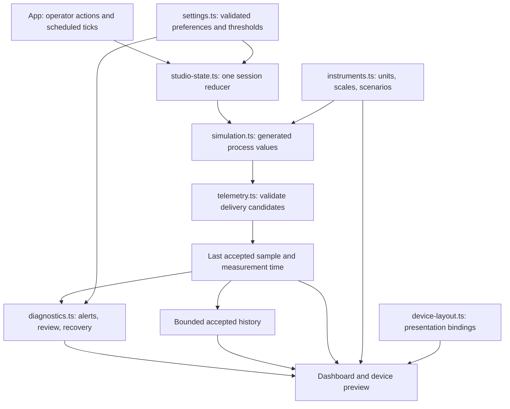

# Simulation and HMI state engine

This directory contains the browser simulator's shared data contracts, process model, sample acceptance, diagnostics, and session state. Its functions run independently of React, making the behavior readable during a code walkthrough and reproducible in unit tests.

**SIMULATED — NOT LIVE EQUIPMENT.** The engine generates measurements locally. It does not read sensors, connect to a controller, issue actuator commands, or implement safety interlocks.

[Repository guide](../../README.md) · [Source overview](../README.md) · [Test guide](../../tests/README.md) · [Production HMI architecture](../../docs/HMI_ARCHITECTURE.md)

## Data flow



`types.ts` supplies the shared vocabulary throughout the diagram. The UI owns browser timers, storage access, and downloads; the engine supplies transformations and state. Device layout edits affect presentation without writing back into process measurements or diagnostic thresholds.

## Immediate contents

```text
engine/
├── README.md          # Start here for the data flow and demo reading order.
├── types.ts           # Signals, delivery quality, settings, alerts, and session contracts.
├── instruments.ts     # Timing/capacity constants, labels/units/scales, modes, scenario narration.
├── simulation.ts      # Seeded coupled process model and scripted process/delivery faults.
├── telemetry.ts       # Runtime sample shape, numeric, range, version, and time-order checks.
├── diagnostics.ts     # Hysteresis, accepted-sample debounce, timeout, acknowledgment, events.
├── settings.ts        # Defaults, configuration validation, and a small storage interface.
├── studio-state.ts    # Session lifecycle/reducer, accepted history, and simulated CSV exports.
└── device-layout.ts   # Six-slot display binding, label/scale validation, and drawing helpers.
```

Names use lowercase kebab-case for multiword domain modules. React components in the neighboring directory retain PascalCase. Historical references to `model.ts`, `studio.ts`, and `device.ts` correspond to `instruments.ts`, `studio-state.ts`, and `device-layout.ts` respectively; their responsibility is clearer without changing behavior.

## Read the engine during a demo

1. Open [types.ts](types.ts). Explain `values` as generated process truth and `received` as the last accepted observation. A delivery fault can freeze the observation while the model continues.
2. Open [instruments.ts](instruments.ts), then [simulation.ts](simulation.ts). Show the fixed 500 ms step, replay seed, and scenario timing. The guided duration describes the sequence; the simulator keeps running afterward until paused or reset.
3. Open [telemetry.ts](telemetry.ts). Follow a candidate through own-field/version checks, finite numbers, demonstration bounds, and timestamp ordering. Rejection preserves exact valid readings and their age.
4. Open [diagnostics.ts](diagnostics.ts). Demonstrate a process warning becoming critical, a delivery timeout, and recovery. Debounce requires distinct fresh accepted samples. Hysteresis requires movement beyond a recovery margin. Acknowledgment records review while the condition remains active.
5. Open [studio-state.ts](studio-state.ts). Trace `tick`, `scenario`, `pause`, and `reset`. Manual startup prepares an accepted time-zero sample but displays standby; `hasStarted` distinguishes standby from pause. Reset/replay preserve preferences and clear session evidence.
6. Open [device-layout.ts](device-layout.ts). Apply a label or scale edit and show that process readings and alarms remain unchanged. Only the drawn indicator is clipped to a customized scale; the numeric reading remains intact.

## Relationships and limits

| Concern | Owner and relationship |
| --- | --- |
| Accepted measurement | `telemetry.ts`; shared by all views through `studio-state.ts`. Timestamp means simulation seconds, not a synchronized equipment clock. |
| Display units | `instruments.ts`; converts pressure/temperature for views. Samples, threshold editors, and CSVs retain canonical psi/°F values. |
| Configurable alarm behavior | `settings.ts` validates thresholds, recovery margins, debounce, and timeout. These are demonstration settings rather than equipment limits. |
| Data quality versus process condition | Rejection and staleness describe observation quality; process severity describes the retained accepted values. They are separate states. |
| History and events | At most 240 accepted samples and 100 events in memory. Full-cadence history represents about 120 seconds; gaps can extend the elapsed span. These are not durable historian/audit records. |
| Persistence | App uses `settings.ts` with browser localStorage. Layout and event/session evidence remain session-only. Blocked storage falls back gracefully. |
| Browser scheduling | App schedules ticks; the engine advances fixed simulation time. Pause suspends simulated timeout detection. No real-time equipment guarantee follows. |
| Future industrial integration | Would require protocol adapters, authenticated/authorized commands, calibrated units/limits, quality and clock semantics, durable evidence, and independent safety design. None is supplied by these modules. |

## Development and validation

Run these commands from the repository root after installing dependencies:

```sh
npm run typecheck
npm test
npm run test:watch
npm run dev
```

The unit suites cover deterministic replay, bounds, state transitions, telemetry rejection/recovery, diagnostic boundaries, settings, exports, standby, and display properties. See the [test guide](../../tests/README.md) for file-level relevance and limitations. `npm run test:e2e` checks browser interactions, while `npm run build` and `npm run build:pages` validate the two hosting bases. Passing simulator checks does not validate equipment response or an industrial safety function.
