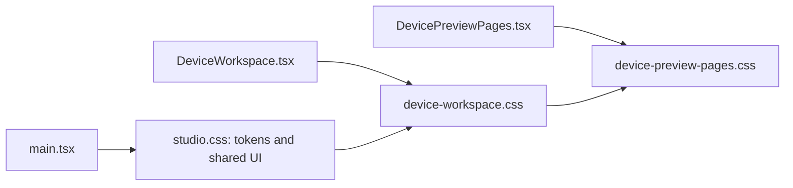

# Presentation styles

All application CSS is grouped here without changing selectors, declarations or their cascade order. The shared studio theme surrounds an intentionally dark device cockpit. These are browser visuals, not a qualified industrial-panel specification.



```text
styles/
├── README.md                 # Cascade and review guide
├── studio.css                # Day/night tokens, shell, gauges, controls and quality states
├── device-workspace.css      # Signal browser, six slots and property editor
└── device-preview-pages.css  # Five page layouts, softkeys and later cockpit refinements
```

[Components](../components/README.md) supply semantic markup, selection/quality classes and textual cues. Later rules intentionally override earlier structure: do not alphabetize selectors or merge repeated blocks casually. Responsive and reduced-motion rules retain control access while leaving simulation logic unchanged. All fonts are local system fonts.

Run `npm run dev` for visual review and `npm run test:e2e` for existing layout/keyboard checks. After changes, run both build commands and `npm run verify:static -- --skip-build` from root. Tests generate captures: inspect the resulting diff before accepting new approved images.

Demo talking points: show day/night, narrow-width reflow, visible keyboard focus, and written stale/critical state alongside color. Browser layout tests do not establish physical touch accuracy, full screen-reader support, environmental readability or safety compliance. [Root](../../README.md).
