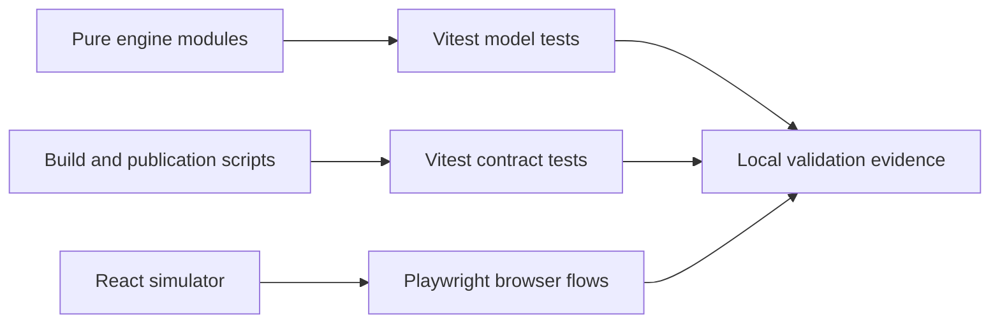

# Test navigation

This directory protects the browser HMI simulator and the scripts that preserve its published evidence. Start with the pure engine tests when explaining behavior, then show the browser flows. Run commands from the repository root.



```text
tests/
├── README.md                       This navigation and test inventory
├── studio-engine.test.ts           Simulation, reducer, diagnostics, settings and CSV
├── device-layout.test.ts           Presentation-only bindings, labels and scales
├── display-standby.test.ts         Prepared model sample versus display wake state
├── telemetry.test.ts               Acceptance, stale readings, fault evidence and recovery
├── privacy-content.test.ts         Honest disclosure and approved public attribution
├── test-report-privacy.test.ts     CI JSON sanitization and safe selected-file handling
├── deployment-workflows.test.ts    Workflow permissions, artifacts and Pages freshness
├── release-workflow.test.ts        Release identities, packages and mocked publication
└── e2e/                            Browser interactions and layout; see its README
```

The maintained suite has **eight Vitest files containing 100 cases** and **two Playwright files containing 17 browser cases**. Parameterized cases count separately. Renaming files did not remove or consolidate assertions.

| File | Assessment after this cleanup | Why it remains maintained |
| --- | --- | --- |
| `studio-engine.test.ts` | Relevant | Covers reproducibility, finite bounded signals, session actions, alert semantics, preferences and labeled exports. |
| `device-layout.test.ts` | Relevant | Invalid presentation edits must not partly change a slot or the process model. |
| `display-standby.test.ts` | Relevant | Start, pause before a first tick, reset and replay distinguish display state from prepared telemetry. |
| `telemetry.test.ts` | Relevant | Only accepted readings update history/freshness; malformed deliveries retain values and record recovery. |
| `privacy-content.test.ts` | Relevant; source references updated | The actual authored application/report text remains the positive fixture. |
| `test-report-privacy.test.ts` | Relevant; OS-dependent junction setup | Sensitive JSON is redacted; an escaping report path is rejected. A denied junction setup is an environment limitation. |
| `deployment-workflows.test.ts` | Needed updating; corrected | Normalize the loaded CI fixture to LF so Windows CRLF checkouts exercise the same negative multiline mutation. |
| `release-workflow.test.ts` | Relevant | Tag/source/byte mismatches block packaging; publication is always mocked. |
| `e2e/studio.spec.ts` | Relevant; wording clarified | Controls update **simulated** telemetry; browser flows exercise the visible application. |
| `e2e/device-pages.spec.ts` | Relevant | Device navigation, ACK, retained trends, standby and responsive pages share central state. |

See [the full relevance assessment](../docs/TEST_RELEVANCE.md) for baseline findings, layered overlap and coverage gaps. No file was classified obsolete and no test was deleted.

## Running the suites

```sh
npm run typecheck
npm test
npm run test:ci
npm run test:e2e
```

`npm test` uses the `tests/**/*.test.ts` selection in [Vite configuration](../vite.config.ts); it does not execute `.spec.ts` files. [Playwright configuration](../playwright.config.ts) separately selects `e2e/`, starts the Vite development server and runs one worker. Windows PowerShell can use `npm.cmd` if script execution policy blocks `npm.ps1`.

The test-report suite creates a junction in its temporary fixture. A sandbox or Windows policy may deny that operation before the assertion runs; retain and explain that result instead of deleting the protection. Release fixtures need `tar` on PATH. Browser setup and tracked-output effects are documented in [e2e/README.md](e2e/README.md).

## How to explain these tests

Use `telemetry.test.ts` to demonstrate the difference between a bad sample and a valid reading that indicates a process fault. Follow with `studio-engine.test.ts`: debounce requires repeated accepted samples, hysteresis reduces alert chatter, and acknowledgment records review without repairing a condition. `device-layout.test.ts` then shows why changing a display scale must not change canonical readings or alarm thresholds.

Unit and browser checks intentionally overlap: pure tests check exact data/state boundaries; browser tests check rendering and controls; [static-build verification](../scripts/validate-static-builds.mjs) checks compiled assets under both public bases. These are different regression signals, not evidence of live equipment or production safety certification. There is no hardware transport, full assistive-device audit, long-duration soak or physical interlock verification here.

[Root navigation](../README.md) · [Engine guide](../src/engine/README.md) · [Script guide](../scripts/README.md)
