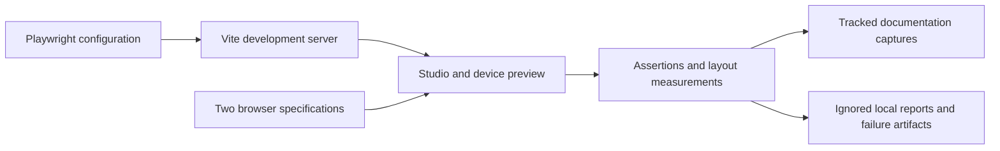

# Browser demonstration checks

These Playwright tests exercise the visible React simulator through its controls. They use an isolated browser context per test; most guided sequences use a controlled clock so faults and recovery can be explained without waiting for real time. A separate wall-clock smoke observes three simulated seconds and pause behavior.



```text
e2e/
├── README.md              Browser setup, output effects and demo interpretation
├── studio.spec.ts         12 application/control/scenario/accessibility/export cases
└── device-pages.spec.ts    5 device navigation/ACK/trend/layout/standby cases
```

## Commands and browser selection

From the repository root:

```sh
npm run test:e2e
npm run test:e2e -- --list
npm run test:e2e -- tests/e2e/device-pages.spec.ts
```

The [configuration](../../playwright.config.ts) starts `npm run dev -- --port 5173 --strictPort` at `http://127.0.0.1:5173`. Local runs default to installed Microsoft Edge; `PW_BROWSER_CHANNEL` selects another installed Chromium channel such as `chrome`. In CI, Chromium is installed with `npx playwright install --with-deps chromium` and selected with `CI=true`. The suite runs with one worker and no retries. The selected-case command is useful for iteration; a filtered run is not a full-suite validation result.

## What each file protects

`studio.spec.ts` covers rejected-delivery retention/staleness/recovery; oil/thermal fault escalation and acknowledgment; atomic display edits; keyboard selection; view/theme/width checks; simulated start/pause/reset; guided selection/replay; communication gaps; persistent settings; CSV bytes; and authentic screenshots. Its 18 application combinations cover three views, two themes and three widths. Computed palette contrast and focus checks are bounded regressions, not a complete accessibility assessment.

`device-pages.spec.ts` covers five preview tabs with arrow/Home/End navigation, softkeys, cross-view acknowledgment, retained accepted-history trends, 30 page/theme/width combinations, minimum selected readout sizes, and standby zeroes across units/start/pause/reset. The preview reads the same central data as the desktop dashboard.

## Outputs require review

Passing runs deliberately write twelve screenshots to tracked `docs/assets/` paths. This is the existing evidence-capture contract used by CI and the report workflow. Running a test can therefore change the Git working tree even when application behavior is correct. Review those captures separately and preserve approved historical screenshots when the sprint does not authorize replacing them.

JSON measurements are written beneath ignored `.local/`; the JSON test report is `.local/e2e-results.json`. Failure traces and screenshots use ignored `test-results/`. Git commit/diff capture is disabled, and CI sanitizes its explicitly retained JSON before uploading artifacts. Browser traces and image contents still need human review.

For the demo, pair `device-pages.spec.ts` with the **Faults** and **ACK** tabs to explain why acknowledgment does not clear a process condition. Pair the rejection case with **Trends** to show retained readings aging instead of silently becoming zero. Neither clock-driven checks nor narrow viewports validate physical equipment, a cellular network, industrial timing guarantees or target HMI firmware.

[Test inventory](../README.md) · [Full assessment](../../docs/TEST_RELEVANCE.md) · [Root navigation](../../README.md)
